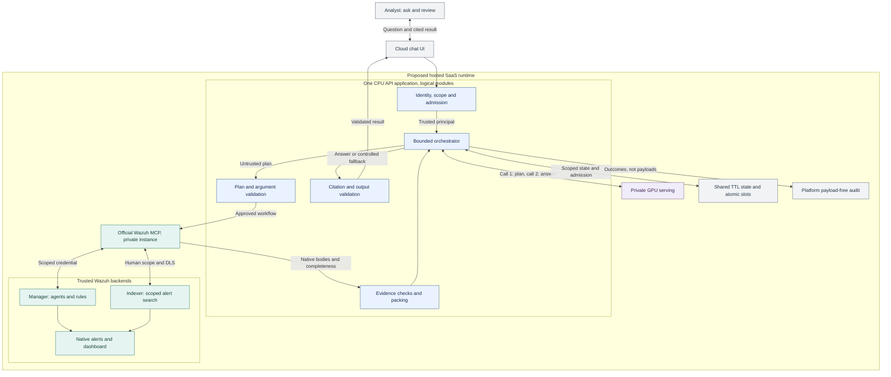
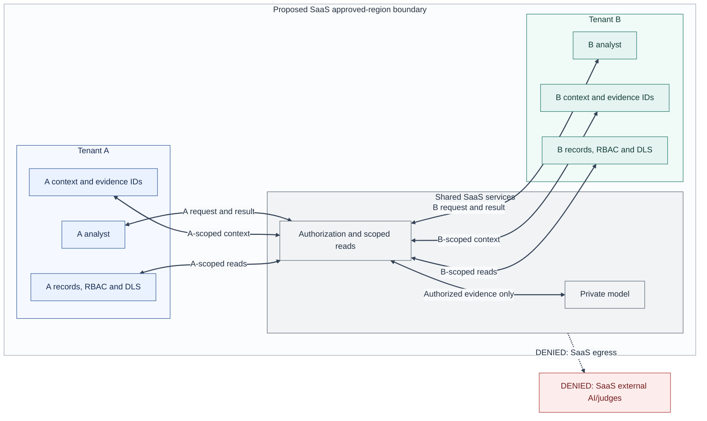
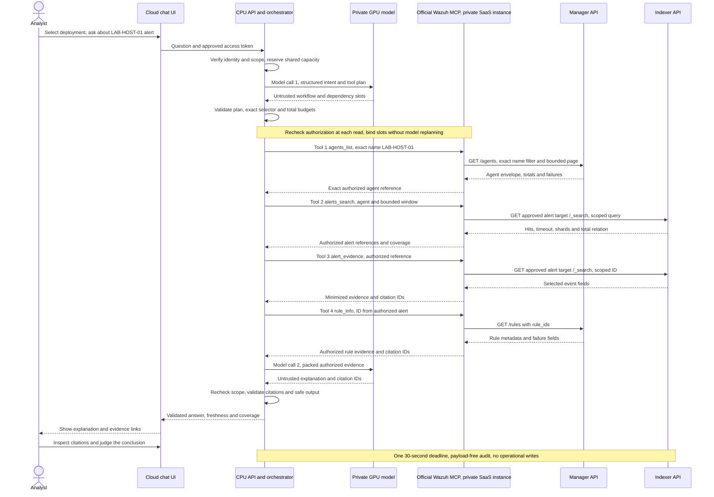

# Phase 3: Design the Service

I would build an official Wazuh-maintained open-source Model Context Protocol (MCP) server and a private Wazuh Cloud investigation assistant that uses it. Community developers could also use the server independently with their own compatible AI clients. This proposal develops the direction I chose in [Phase 2](../phase2/PHASE2.md). I exercised three lab API reads, correlating agent `002`, an alert and rule `554`; those observations ground the integration example, not the proposed products or model quality.

The supporting material is the [lab evidence](assets/evidence/EVIDENCE.md), private evaluation plan, synthetic cases and [before-pilot checks](OPEN-QUESTIONS.md). The compact [assumptions section](#proposal-assumptions-and-before-pilot-checks) distinguishes my design choices from platform contracts to validate.

## 1. What does the service do, and for whom?

I would build a governed, read-only investigation chatbot for Wazuh Cloud analysts and detection engineers. It would interpret questions, retrieve evidence the person may already read, explain alerts and rules, and cite the supporting records. For example, an analyst could ask why an alert appeared for a selected endpoint and which observations support further investigation. I would limit its domain to Wazuh investigation, rule context and an approved, versioned documentation bundle, not model-selected web pages.

AI is central to interpreting and explaining the evidence, but it does not decide access or declare an environment safe. I would distinguish observations, hypotheses and missing information. People would inspect citations and decide what to do next. The service would not publish rules, run commands, trigger Active Response, quarantine hosts or replace case management. I would measure whether it improves investigation before claiming business value.

I positioned this as on-demand investigation rather than another periodic AI Analyst report. Ordinary Cloud customers would not install models on managed nodes: I would propose Wazuh-operated platform services under A1.

### Two ways to use the official MCP

I would publish the server code, tool contracts, integration documentation and versioned releases as a first-class open-source Wazuh project. The hosted assistant would be one client of that project, not its only permitted consumer.

| Mode | Connection I would support | Inference and data-processing boundary |
|---|---|---|
| Hosted Wazuh Cloud assistant | Wazuh would operate a private instance of the official open-source MCP server for the assistant. | Private SaaS inference, tenant/state/audit controls and the hosted request budgets and GPU costs below. |
| Independent community integration | Developers would configure the official MCP server for their authorized Wazuh deployment and connect a compatible AI client or agent. | Developers could choose their model, including an external provider, under their organization's processing, retention and egress policy. Those client decisions are outside the SaaS offering and its guarantees. |

Open source would not mean anonymous access, public customer data or automatic access to the SaaS-private endpoint. The MCP would be model-agnostic: it would expose authorized tools, not select or run a community client's LLM. Authentication, effective-user permissions, scoped reads, bounded queries, minimized output and credential protection would remain server-side requirements in both modes.

### Minimal deployable baseline

I would start the hosted assistant with four runtime facilities, reusing existing platform capabilities where available:

| Facility | Responsibility |
|---|---|
| One CPU API/orchestrator deployment | Token checks, authorization, admission, planning validation, evidence packing and output validation are modules in one application, not separate microservices. CPU replicas would share admission accounting. |
| One private instance of the official open-source Wazuh MCP server | Expose the same four read-only typed tools, enforce backend scope and validate native response envelopes with separate backend credentials. |
| Private GPU model serving | Start with one warm ready replica, at most two, using the bounded admission policy in question 7. |
| One shared regional time-to-live (TTL) state facility | Scoped context/evidence references, authorization versions, and atomic global/tenant admission counters and the small queue. Payload-free audit would reuse platform observability. |

I would not add a broker, vector database or a service for every logical check. If authorization or shared state is unavailable, I would deny admission and protected reads, stop in-flight work safely and withhold output whose scope cannot be revalidated. Local fallback state must not bypass the shared limits.

### Proposed components and data flow

Editable source: [components.mmd](assets/diagrams/components.mmd). This proposed hosted SaaS runtime uses a private instance of the official open-source MCP; community clients are described above, outside its private-model boundary. Boxes inside the CPU application are logical modules. Offline evaluation is described in the evaluation plan.

## 2. How does it connect to a user's Wazuh deployment, and what data does it need from it? Show it with real responses from the Wazuh API of your lab.

I ran the lab dashboard requests and used AI to organize the three JSON responses and five screenshots. The [evidence record](assets/evidence/EVIDENCE.md#collected-evidence) pairs each exact request with its complete inline response and screenshot, retaining native values and provenance.

### Observed lab read path: agent 002 -> alert -> rule 554

| Read | Observed evidence |
|---|---|
| [C1, agent](assets/evidence/EVIDENCE.md#c1-agent-response) | `ubuntu-lab-02`, active agent `"002"`, agent version `Wazuh v4.14.9`. One affected item, total 1 and no failures. This is not a Manager/Indexer version. |
| [C3, alerts](assets/evidence/EVIDENCE.md#c3-alert-search-response) | Three returned hits from 64 exact matches for agent `"002"`. The first cites rule `"554"`, level 5, `File added to the system.`, decoder `syscheck_new_entry`, at `2026-11-04T15:19:48.251+0000`. |
| [C2, rule](assets/evidence/EVIDENCE.md#c2-rule-response) | Enabled rule `554`, level 5, the same description and decoder context. Manager preserves a numeric rule ID, Indexer a string. |

Both Manager envelopes report `error: 0`; the Indexer reports no timeout or shard failure, and all three success screenshots show HTTP 200. The query had no time filter, so it does not validate the proposed lookback control or permission isolation. The other two rootcheck hits do not by themselves establish compromise. I keep [console navigation and the uncaptured routing mistake](assets/evidence/EVIDENCE.md#console-navigation-and-process) separate from these responses.

### Proposed integration

The official MCP server would expose this small read-only tool catalog in both consumption modes. Every argument would be a typed data transfer object (DTO), validated independently of the model; the server would select deployment, endpoints and index targets from trusted configuration.

| Proposed tool | Minimum input and evidence | Documented read path |
|---|---|---|
| `agents_list` | Exact validated `name` or `agent_id` for endpoint resolution, plus bounded status/limit/cursor; return permitted agent references and status. | Manager `GET /agents`, with a backend name/ID filter and bounded `offset`/`limit`. |
| `rule_info` | Validated rule ID; description, level and relevant metadata. | Manager `GET /rules?rule_ids=...`; optional file read only through a trusted filename catalog. |
| `alerts_search` | Authorized agent reference, rule/level filters, bounded lookback and page; selected alert fields. | Indexer `GET /{index}/_search`, backend-approved `wazuh-alerts-4.x-*`. |
| `alert_evidence` | Previously authorized evidence reference; minimized selected event details. | Scoped indexer search for that record, not an arbitrary document or URL. |

For a named endpoint, I would require one exact name/ID selector, validate its length/type and reject wildcard or query syntax. The MCP server would filter at the backend and verify exact matches under the caller's scope, preserving leading zeros in IDs. It would not scan inventory or depend on the first 100 agents. Zero matches would mean no visible match, not proof the endpoint does not exist; multiple visible matches would require clarification. Inventory listing would remain a separate bounded use of the same tool.

I would inspect manager `error`, `data.affected_items`, `total_affected_items`, `failed_items` and `total_failed_items`, even after HTTP success. For indexer responses I would check `timed_out`, `_shards.failed` and `hits.total.relation`. A first page or `gte` lower bound cannot support an exhaustive count.

The MCP server would build queries deterministically, cap `from`/`size`, and bind opaque cursors to principal, deployment, authorization version and query. GET-body handling succeeded in the lab Indexer console; I would validate service-ingress compatibility before a pilot and initially return complete, non-streamed responses. Community instances could connect to self-managed Wazuh or documented, authorized API routes. Public Cloud API access has support/source-IP enablement and read-only limits; it does not establish a new public MCP endpoint, A1's provider-internal route or write access. I would document client compatibility and connection setup without inventing a Cloud OAuth contract. [S1-S5]

## 3. How does it keep each customer's data separate, and how do users authenticate?

For the hosted assistant, I would reuse existing Wazuh sign-in through an approved access-token contract, not invent a new Cloud authentication API. The API boundary would verify issuer, audience, signature and expiry, then resolve membership, deployment and effective permissions server-side. I would recheck effective authorization before every tool read and final output. Revocation or a same-user permission change would cancel affected work and invalidate context, evidence references and cursors under A2; unavailable authorization would fail closed.

Every official MCP instance would authenticate callers and enforce effective-user permissions on each tool read and evidence-reference lookup. Tenant, deployment, index and identity would never be model-controlled tool arguments. I would use least-privilege Manager role-based access control (RBAC) and Indexer document-level security (DLS), or equivalent scoped delegation. A broad service credential plus a prompt filter is insufficient. An MCP-audience token must not be passed blindly downstream; backend credentials would remain separate and never enter model context or tool responses. Choosing an external community client would not waive these server-side controls. [S5]

In the hosted assistant, I would partition ephemeral context and evidence references by tenant, deployment, user and authorization version, with a proposed 15-minute TTL and earlier invalidation on logout or permission change. I would keep any minimized payload only for that bounded context lifetime, with no payload backups. I would forbid cross-tenant retrieval or memory reuse, and disable shared prompt/KV caches and production fine-tuning by default. Shared inference would need request isolation and resource cleanup verification.

### Tenant boundaries and access

Editable source: [tenant-data-boundaries.mmd](assets/diagrams/tenant-data-boundaries.mmd). This hosted SaaS isolation view combines API/MCP access checks in one logical box, outside the model. Blue/teal identify tenants, neutral fills shared facilities, and red denied SaaS egress; explicit labels carry scope independently of color. Context partitions remain logical, and community clients are outside this view.

| Protected access | Reader and boundary I would enforce |
|---|---|
| Backend credentials | Only the MCP server identity would read the regional credential store, never the model or analysts. |
| Audit events | Designated restricted audit readers would see payload-free operational events, not conversation content. |
| Maintenance | Approved operators would use audited access to API/MCP, inference and state facilities; support would have no default content access. |

For the hosted SaaS, I would keep prompts, evidence, answers, local judges, context and observability within A3's proposed `deployment_region`, with encryption in transit/at rest and restricted key access. Authorized users would receive their own results in the browser. Infrastructure-processor approval would be a deployment requirement; privileged access, misconfiguration and inference leakage remain risks. Local inference and MCP do not certify compliance or establish absolute privacy. These SaaS processing/retention controls do not automatically apply to independent clients or forks.

Audit events would contain operation/auth outcome, counts, latency, versions, error categories and controlled opaque IDs, not questions, raw prompts, tool bodies, answers, access tokens or secrets. Metrics would use minimal cohort labels, not raw identities or payload hashes. Logs, traces, metrics and any metadata backups would stay regional, with external telemetry disabled. I accepted ephemeral history and a provisional 30-day payload-free audit window for the simulation; the 15-minute context/evidence TTL is my implementation proposal, not Wazuh or legal policy. I would verify deletion, metadata retention and privileged-access mappings before a pilot. Persistent history would require a separate purpose, encrypted store and approved minimal retention.

## 4. Where does AI fit in, what can go wrong with it and how do you control it?

For the hosted assistant, I would allow **at most two local model calls per request**: a structured intent/tool plan, then an evidence-grounded answer. The backend would execute an allowlisted workflow, binding dependency slots from authorized results without extra model replanning. Missing or ambiguous scope would produce a clarification before retrieval; the reply would start a new admitted request. A failed planning call would stop without tools. I would not retry model calls in this baseline or add a hidden runtime judge or agent loop. The model-agnostic MCP server would not impose this model-call count on community agents or run their LLM.

OpenAI's open-weight `gpt-oss-20b` and `gpt-oss-120b`, under Apache 2.0, are candidates, not selected models or hosted OpenAI API calls. Their published MXFP4 memory-fit claims (16 GB for 20b and a single 80 GB GPU for 120b) are not production concurrency or context-capacity guarantees. I would compare them under equal private conditions. Harmony channel/tool serialization and tool continuation are mandatory; flattening messages or logging internal reasoning is unacceptable. An OpenAI-compatible private endpoint is not necessarily OpenAI-operated inference. The archived vLLM recipe and incomplete reference API implementation are background, not a production deployment plan. [S7-S10]

| Failure or attack | Independent proposed control |
|---|---|
| Prompt injection in a question, log or retrieved text | Treat evidence as untrusted data; never grant it instruction authority. System prompts and domain classification are fallible, not authorization boundaries. |
| Command/query injection or exfiltration | No shell, filesystem, `eval`, arbitrary URLs, WQL/DSL, indices or script fields; validate typed inputs and build queries server-side. |
| Wrong scope or fabricated evidence | Backend-issued caller-scoped evidence IDs; reject unknown/unauthorized citations and distinguish facts from inference. Citation membership alone cannot prove semantic support. |
| Unsafe output or resource exhaustion | Sanitize Markdown/HTML, links and remote images; cap tokens, bytes, pages, time and per-tenant concurrency. |

A request for an omelette recipe or shelving instructions would receive a brief Wazuh-only refusal before retrieval. Legitimate security logs containing commands or shell characters must remain analyzable as data; I would not use a blanket character blacklist. I would expose concise explanations and citations, not internal model reasoning. [S6]

### Proposed request budgets

These per-investigation model, token, deadline and admission limits apply to the hosted assistant, not arbitrary community agents. Every official MCP deployment would still enforce per-tool authorization, typed schemas, page/lookback bounds, rate and response-size/time protections, and minimized output independently of the client.

| Resource | Initial hard limit I would enforce |
|---|---|
| Model calls and tokens | At most 2 calls, each at most 8,192 input and 1,024 output tokens; aggregate at most 16,384 input and 2,048 output tokens. |
| Retrieval | At most 4 tool invocations, 2 page-fetch attempts per invocation and 50 items per page; 24-hour maximum lookback; 256 KiB aggregate retrieved bytes. |
| Admission | At most 2 admitted requests per tenant, including queued, active and cancellation-pending work; global capacity follows ready replicas in question 7. |
| Time | One absolute 30-second deadline from API receipt, including authorization, queue wait, retries and output validation. |

I would count the serialized system instructions, tool schemas, question, retained history, tool evidence, citation metadata and Harmony framing in each call's input. Reused context would count again in the second call. All generated tokens, including internal reasoning, would consume the output cap without exposing or logging that reasoning. I would pack with the pinned model tokenizer, removing oldest history and lower-priority evidence first while preserving security instructions, scope and claim support. Omitted evidence would make coverage explicitly partial; an input that cannot fit safely would require a smaller request, not silent removal of safeguards.

Every tool invocation, including a repeated invocation, would consume the four-tool budget. Every page fetch or refetch on retry would consume that invocation's two-attempt allowance, retrieved bytes and retrieval time. A bounded backend retry would not grant another tool, page, token or time budget. The successful four-tool path below leaves no spare invocation for replanning. Truncation would mean partial coverage, not “all results.”

An illustrative deadline allocation is authorization/admission **2 seconds**, including at most **1 second** of queue wait; planning **5 seconds**; retrieval **8 seconds**; answering **13 seconds**; and output checks **2 seconds**, totaling **30 seconds**. I would enforce stage cutoffs against the same absolute deadline, with no extension for retries or a third call. These are proposed controls and pilot targets, not achieved performance.

### One complete user request

Editable source: [request-sequence.mmd](assets/diagrams/request-sequence.mmd). This successful hosted-assistant path uses the SaaS-private instance of the official open-source MCP and the entire four-tool budget. Dependent steps stop on failure; this is not a model-call limit for community clients.

## 5. How would you know that the AI gives users good answers, and how would you notice when it stops doing so?

I would use **promptfoo, which I used at Prowler**, to compare the complete hosted-assistant contract, not only an isolated model prompt. Its provider comparisons, deterministic assertions and configurable local grading would support a repeatable private evaluation. I would also test the official MCP's authentication, effective-user permissions, schemas, bounded reads and credential exclusion independently of any LLM. That choice comes from my prior experience; the official documentation supports the proposed capabilities. [S11-S14]

I prepared hypothetical expected facts, citations, allowed tools and outcomes in cases.json. I would start with these inspectable synthetic cases, then add approved lab cases and private holdouts. The suite would cover injection, tenant and permission changes, false refusals, partial results, call-1 failure, overload/cancellation and token packing. Deterministic checks would enforce scope and budgets; human review or a human-calibrated offline local judge would assess semantic support, not just citation presence.

My proposed gate would require zero **observed** hard security violations in the finite known suite and all critical deterministic assertions passing. I would set quality, latency and cost thresholds after a human-reviewed baseline. I would compare pinned model, quantization, backend, prompt, dataset and tool versions, repeat selected cases and use blind human comparisons. Fixed seeds and temperature zero help repeatability, not guaranteed determinism.

Scheduled synthetic canaries and controlled regression runs would help detect known semantic regressions; payload-free error/latency metrics would show operational drift. Aggregate health cannot prove accuracy on unseen production questions. I would keep targets, graders and results private, explicitly configure local graders, disable sharing/telemetry and enforce network restrictions. The evaluation plan explains this setup and keeps labels outside candidate prompts; offline grading would never become a third runtime call. [S12-S14]

## 6. What happens when the Wazuh API or the model is down?

For the hosted assistant, I would require the following behavior:

| Condition | Behavior I would require |
|---|---|
| Authorization or shared state unavailable | Fail closed before admission, retrieval or output; cancel affected work, with no local-counter bypass. |
| Permission revocation or MCP scope failure | Invalidate affected context/references/cursors, stop dependent reads and withhold stale-scope output; return denied/unavailable. |
| Manager/indexer error, failed items, timeout or failed shards | Mark affected scope incomplete; use only valid evidence with explicit limitations, or return unavailable. Never translate errors into “no threats.” |
| Planning call 1 unavailable or invalid | Return unavailable or clarification as appropriate, without tools or another model attempt. |
| Answering call 2 unavailable or invalid citations | Use bounded validated facts-only cards if evidence and current scope permit, otherwise abstain/unavailable; no external fallback or third call. |
| Deadline, page or quota exhausted | Return explicit partial coverage where useful, or unavailable; do not hide truncation. |
| Queue full, tenant ceiling reached or admission wait expired | Reject clearly as overloaded, with retry guidance; do not start model or tool work. |
| Client cancellation or deadline while work is running | Propagate cancellation downstream and suppress late output. Keep the slot occupied until all associated work has actually stopped. |

I would use bounded backend retries with backoff, circuit breakers and cancellation within the existing budgets. If a worker's termination is uncertain, I would quarantine its capacity rather than release it on disconnect or lease expiry and admit overlapping work. Stale evidence would show freshness and scope, and authorization would still have to hold. Native critical alerts and the dashboard would remain independent, so a chat outage would not block Wazuh's normal security workflow.

## 7. What would it cost to run, and what are its main risks?

### Bounded pilot capacity

I would start the hosted assistant with **one warm GPU-serving replica**, scale to **at most two**, and conservatively reserve **one active investigation per ready replica** across both model calls and retrieval. Warming or unready replicas would add no admission capacity. A small **four-slot global queue** would use tenant round-robin selection and FIFO order within each tenant, with **at most one second of waiting** inside the two-second admission budget. The **two-request per-tenant ceiling** would include queued, active and cancellation-pending work.

All CPU replicas would use the same atomic state counters and queue, not independent local allowances or a new scheduler service. I would reject excess load clearly, scale down only idle replicas, and stop admitting work if readiness or shared accounting cannot be trusted. These are initial pilot settings to measure, not throughput or availability guarantees. GPU startup and quota constraints mean scale-out cannot rescue a request past its deadline; the [AWS scale-to-zero guidance](https://docs.aws.amazon.com/sagemaker/latest/dg/endpoint-auto-scaling-zero-instances.html) illustrates startup constraints, not a SageMaker selection.

### Illustrative monthly budget

This illustration covers operating the hosted assistant, including its private MCP instance. It excludes community-operated servers and their chosen external model bills. Open-source project maintenance and release engineering would need a separate estimate, not be hidden in this SaaS runtime budget.

I would calculate provisioned cost as:

`sum(GPU count × provisioned hours × regional GPU-hour rate) + CPU/RAM + storage/network + operations/observability`.

For a useful first budget, I would assume the following, in USD. Every rate and workload below is a budgeting hypothesis, not an AWS quote, measured capacity or an approved operating budget. The GPU rate represents an assumed serving replica, not a promise that either candidate fits that price.

| Assumed item | Calculation | Monthly cost |
|---|---|---|
| One warm GPU-serving replica | 730 hours x $2/hour | $1,460 |
| Second-replica bursts | 60 hours x $2/hour | $120 |
| Other platform costs | CPU, state, storage/network and observability allowance | $300 |
| Operations | 6 hours x $50/hour | $300 |
| **Total** | **(730 + 60) x $2 + $300 + 6 x $50** | **$2,180** |

At an assumed **10,000 completed investigations per month**, that would be **$0.218 per completion**. Failed requests and idle time still incur costs; fewer completions increase that unit cost. Private model-comparison runs and offline grading would have a separate experiment budget. I would replace these assumptions with quotes for the approved `deployment_region`, hardware compatibility and measured load, memory, p95 latency, tokens/second and completion quality before a pilot. A smaller model might reduce capacity cost but increase abstentions or errors; the larger candidate would need to justify its operating cost.

The principal risks are incorrect security conclusions, unauthorized disclosure, regional/retention mistakes, noisy-neighbor exhaustion and operating a model service reliably. Minimization, independent permissions, explicit uncertainty and regression gates reduce these risks without eliminating them. Customer demand and platform integration also remain unproven.

## 8. Which were your main design decisions, and which alternatives did you discard?

| Decision I proposed | Alternative and tradeoff |
|---|---|
| Private Wazuh-operated inference for the hosted assistant | A hosted business inference API could reduce GPU operations but change processors, egress, dependency and cost; it is outside this SaaS baseline. |
| Read-only typed tools and two bounded hosted model calls | Autonomous shell/write tools or an open-ended hosted agent add authority and unpredictable work; community clients retain their own model orchestration. |
| Ephemeral conversation state and payload-free operations logs | Persistent history helps continuity but creates another sensitive store and retention obligation. |
| Official open-source Wazuh MCP with published contracts and releases, plus hosted chat as one client | A closed internal-only adapter would prevent independent community use; open code still requires authenticated, permission-scoped deployments. |

The hosted assistant would remain private-inference only, with no external model/judge option or silent outage fallback. Independent community clients could select external providers under their own organization's processing, retention and egress policy, outside the SaaS offering and its cost illustration. I would document that responsibility boundary without relaxing official MCP authentication, backend/effective-user permissions or credential protection. Provider privacy commitments do not replace those checks or policy review. [S15]

I would use the [before-pilot checklist](OPEN-QUESTIONS.md) to confirm the actual platform contracts and tune the proposal with measurements. The requested lab evidence is already included; integration checks and future model comparisons are deployment work, not missing assignment evidence.

### Proposal assumptions and before-pilot checks

| ID | Design choice or accepted simulation principle | What I would validate before a pilot |
|---|---|---|
| A1 | An official Wazuh-maintained open-source MCP project, published tool contracts/docs/versioned releases, and hosted chat using a private instance. | Server/client compatibility, supported authorized Wazuh routes and hosted provider-internal integration; no public SaaS endpoint is implied. |
| A2 | Reuse existing identity and effective human permissions, an accepted simulation principle. | Token issuer/audience, delegation, revocation and Manager RBAC/Indexer DLS mapping. |
| A3 | AWS is the hosted SaaS simulation assumption; `deployment_region` is a required, still-unselected deployment parameter. | Processor/residency approval for hosted inference, state, judges and observability. `eu-central-1` and `eu-west-2` are alternatives, not approved locations; the UK is not EU residency. |
| A4 | Accepted hosted ephemeral context and provisional 30-day payload-free audit; proposed 15-minute context/evidence TTL and no payload backups. | SaaS deletion, metadata retention, key/access policies and legal review, without extending guarantees to independent clients or claiming compliance approval. |
| A5 | Two-call hosted budgets and bounded one-to-two-replica SaaS capacity are initial controls. | Hosted quality, cancellation, load, queue fairness and deadline behavior; common MCP per-tool protections remain required for every instance. |
| A6 | Compare the hosted assistant's two open-weight candidates privately with promptfoo. | Serving/Harmony compatibility, hardware and human-reviewed golden-case results, separate from community model/provider choices. |

---

### Retained source references

I used retained interface research and checked the official promptfoo guidance for this proposal. Documentation supports the design approach; it does not prove the proposed integration works.

- **S1:** [Wazuh server API reference](https://documentation.wazuh.com/current/user-manual/api/reference.html).
- **S2:** [Wazuh indexer API reference](https://documentation.wazuh.com/current/user-manual/indexer-api/reference.html).
- **S3:** [Cloud technical FAQ](https://documentation.wazuh.com/current/cloud-service/your-environment/technical-faq.html).
- **S4:** [Cloud limitations](https://documentation.wazuh.com/current/cloud-service/your-environment/limitations.html).
- **S5:** [MCP security best practices](https://modelcontextprotocol.io/docs/tutorials/security/security_best_practices).
- **S6:** [OWASP prompt-injection prevention](https://cheatsheetseries.owasp.org/cheatsheets/LLM_Prompt_Injection_Prevention_Cheat_Sheet.html).
- **S7:** [gpt-oss repository](https://github.com/openai/gpt-oss) and [license](https://raw.githubusercontent.com/openai/gpt-oss/main/LICENSE).
- **S8:** [Archived vLLM cookbook recipe](https://cookbook.openai.com/articles/gpt-oss/run-vllm).
- **S9:** [Harmony format](https://cookbook.openai.com/articles/openai-harmony).
- **S10:** [gpt-oss reference implementation](https://github.com/openai/gpt-oss): its reference API implementation is incomplete; the retained inspection is not an executed compatibility result.
- **S11:** [promptfoo assertions and comparisons](https://www.promptfoo.dev/docs/configuration/expected-outputs/). My prior use at Prowler is personal experience, not inferred from this source.
- **S12:** [Pinned Promptfoo offline FAQ](https://github.com/promptfoo/promptfoo/blob/f2b012e3c9f9ffb7b23edf4cf88ea63febf72f5a/site/docs/faq.md).
- **S13:** [Pinned CLI controls](https://github.com/promptfoo/promptfoo/blob/f2b012e3c9f9ffb7b23edf4cf88ea63febf72f5a/site/docs/usage/command-line.md).
- **S14:** [Pinned local-provider documentation](https://github.com/promptfoo/promptfoo/blob/f2b012e3c9f9ffb7b23edf4cf88ea63febf72f5a/site/docs/providers/ollama.md).
- **S15:** [OpenAI enterprise privacy](https://openai.com/enterprise-privacy/).
