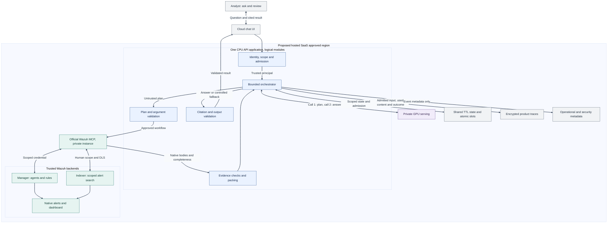
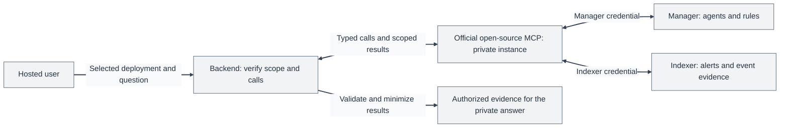
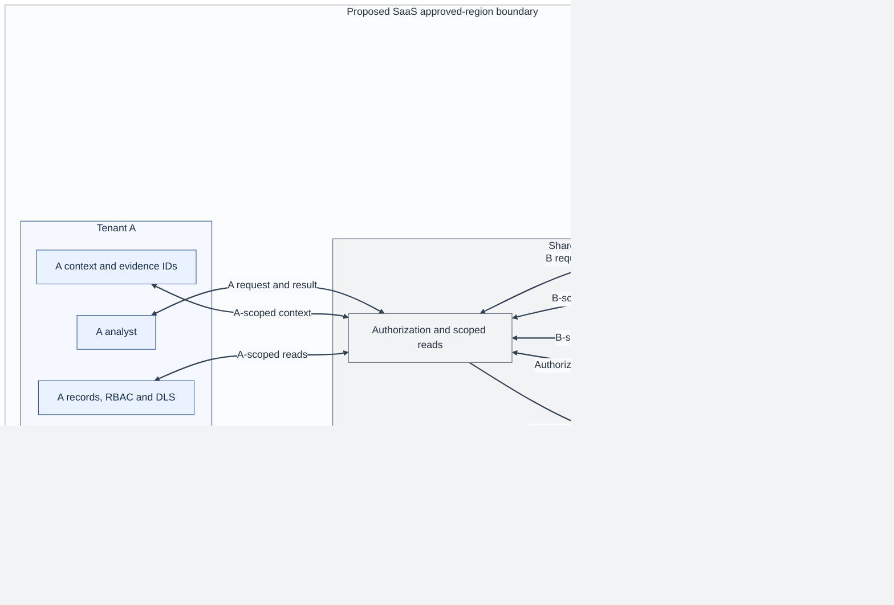
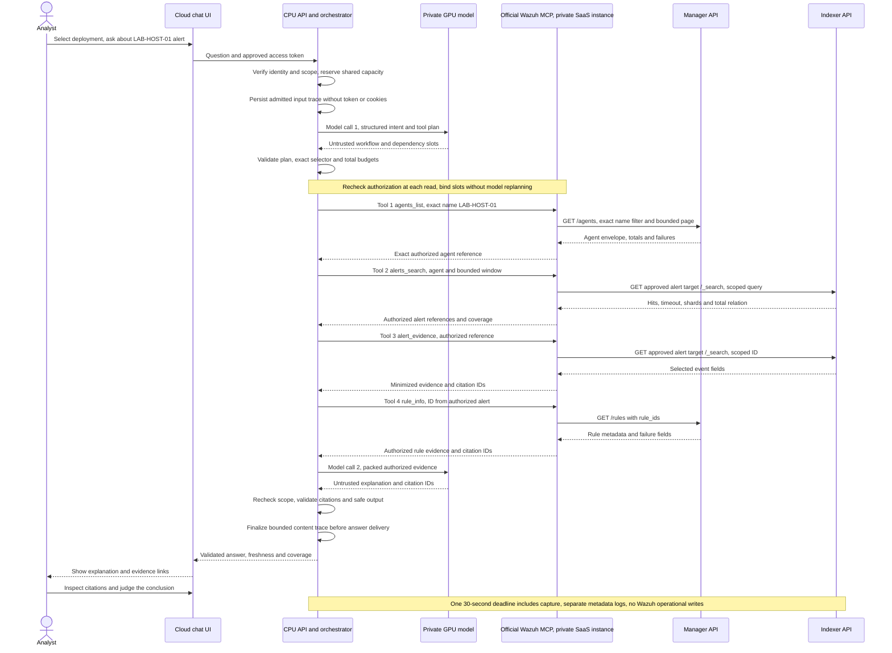

# Phase 3: Design the Service

I would build an official Wazuh-maintained open-source Model Context Protocol (MCP) server and a private Wazuh Cloud investigation assistant that uses it. Community developers could also use the server independently with their own compatible AI clients. This proposal develops the direction I chose in [Phase 2](../phase2/PHASE2.md). I exercised three lab API reads, correlating agent `002`, an alert and rule `554`; those observations ground the integration example, not the proposed products or model quality.

The supporting material is the [lab evidence](assets/evidence/EVIDENCE.md), [private evaluation plan](assets/evaluation/EVALUATION-PLAN.md), [synthetic cases](assets/evaluation/cases.json) and [before-pilot checks](OPEN-QUESTIONS.md). The compact [assumptions section](#proposal-assumptions-and-before-pilot-checks) distinguishes my design choices from platform contracts to validate.

## 1. What does the service do, and for whom?

I would build a governed, read-only investigation chatbot for Wazuh Cloud analysts and detection engineers. It would interpret questions, retrieve evidence the person may already read, explain alerts and rules, and cite the supporting records. For example, an analyst could ask why an alert appeared for a selected endpoint and which observations support further investigation. Its domain would be limited to Wazuh investigation, rule context and an approved, versioned documentation bundle, not model-selected web pages.

AI is central to interpreting and explaining the evidence, but it does not decide access or declare an environment safe. The model's explanation would distinguish observations, hypotheses and missing information. People would inspect citations and decide what to do next. The service would not publish rules, run commands, trigger Active Response, quarantine hosts or replace case management. I would measure whether it improves investigation before claiming business value.

I positioned this as on-demand investigation rather than another periodic AI Analyst report. Ordinary Cloud customers would not install models on managed nodes: I would propose Wazuh-operated platform services under A1.

### Two ways to use the official MCP

I would publish the server code, tool contracts, integration documentation and versioned releases as a first-class open-source Wazuh project. The hosted assistant would be one client of that project, not its only permitted consumer.

| Mode | Connection I would support | Inference and data-processing boundary |
|---|---|---|
| Hosted Wazuh Cloud assistant | Wazuh would operate a private instance of the official open-source MCP server for the assistant. | Private SaaS inference, tenant/state/audit controls and the hosted request budgets and GPU costs below. |
| Independent community integration | Developers would configure the official MCP server for their authorized Wazuh deployment and connect a compatible AI client or agent. | Operators would choose their logging and model/provider policy, including any external provider, under their organization's processing, retention and egress rules. The official server would not automatically send application content home to Wazuh. These decisions are outside the SaaS offering and its guarantees. |

Open source would not mean anonymous access, public customer data or automatic access to the SaaS-private endpoint. The MCP would be model-agnostic: it would expose authorized tools, not select or run a community client's LLM. Authentication, effective-user permissions, scoped reads, bounded queries, minimized output and credential protection would remain server-side requirements in both modes.

### Minimal deployable baseline

I would start the hosted assistant with four runtime facilities, reusing existing platform capabilities where available:

| Facility | Responsibility |
|---|---|
| One CPU API/orchestrator deployment | Token checks, authorization, admission, planning validation, evidence packing and output validation are modules in one application, not separate microservices. CPU replicas would share admission accounting. |
| One private instance of the official open-source Wazuh MCP server | Expose the same four read-only typed tools, enforce backend scope and validate native response envelopes with separate backend credentials. |
| Private GPU model serving | Start with one warm ready replica, at most two, using the bounded admission policy in question 7. |
| Shared regional platform storage | Separate logical stores for time-to-live (TTL) context/evidence references, authorization versions and atomic admission counters/queue, and for encrypted product traces. Operational/security events would reuse platform observability, separate from trace content. |

I would not add a broker, vector database or a service for every logical check. If authorization or shared state were unavailable, the CPU backend would deny admission and protected reads, stop in-flight work safely and withhold output whose scope could not be revalidated. Local fallback state must not bypass the shared limits.

### Proposed components and data flow

Editable source: [components.mmd](assets/diagrams/components.mmd). This proposed hosted SaaS runtime uses a private instance of the official open-source MCP; community clients are described above, outside its private-model boundary. Boxes inside the CPU application are logical modules. Offline evaluation is described in the [evaluation plan](assets/evaluation/EVALUATION-PLAN.md#private-test-topology).

## 2. How does it connect to a user's Wazuh deployment, and what data does it need from it? Show it with real responses from the Wazuh API of your lab.

For the hosted assistant, the CPU backend would resolve the user's selected deployment and verified human permissions to trusted backend configuration, then use a private instance of the official open-source Wazuh MCP server. That configuration would identify two distinct API planes: the **Manager for agent inventory and rule definitions**, and the **Indexer for alerts and event evidence**. The MCP server would use separate, least-privilege backend credentials for each plane, constrained to the person's effective scope.

The authenticated backend would validate every typed tool call and recheck authorization before executing it. The model would not choose a tenant, endpoint or index, receive credentials, make raw HTTP requests or compose arbitrary query DSL. The MCP server would construct the permitted native reads; the CPU backend would receive the results, validate completeness and scope, and minimize the evidence before passing it to the private model for explanation. Independent community users could configure the same official MCP for their authorized deployment and compatible AI client, outside the hosted assistant's private-inference boundary.

### Connection and returned evidence

Editable source: [api-integration.mmd](assets/diagrams/api-integration.mmd). This proposed hosted integration view shows connections and evidence flow, not model-call order. The [full request sequence](#one-complete-user-request) retains the two model calls and four-tool path.

### How the system would use the data in an answer

For example, a user could ask: **"Why did ubuntu-lab-02 report 'File added to the system.', and what evidence supports that explanation?"** The orchestrator would execute the following bounded workflow, with dependencies bound by the backend rather than extra model replanning:

| Step | Responsible plane and proposed read | Necessary returned fields and service use |
|---|---|---|
| 1. `agents_list` | Manager `GET /agents`, exact validated name `ubuntu-lab-02`, bounded page. | `id`, `name`, `status`, `version`: resolve the visible endpoint to string ID `"002"`, retain its status and identify the agent version, not the server version. |
| 2. `alerts_search` | Indexer `GET /{index}/_search`, trusted `wazuh-alerts-4.x-*` target, authorized agent and bounded time/page filters. | Alert reference, `timestamp`, `agent.id/name`, `rule.id/description/level`, `decoder.name`: select the related file-added alert, correlate its agent and rule, and cite when and what Wazuh reported. Totals and completeness fields qualify coverage. |
| 3. `alert_evidence`, if further fields are needed | Indexer scoped search for a previously authorized evidence reference, never an arbitrary URL or document. | Only required event details, such as a file path if present: explain the specific observation without guessing missing fields. This is a proposed additional scoped read, not a fourth captured response; no event-detail read was captured. |
| 4. `rule_info` | Manager `GET /rules?rule_ids=554`, ID bound from the authorized alert. | `id`, `status`, `level`, `description`, `details.decoded_as` and relevant groups: relate the alert to the enabled file-added rule and decoder context, not infer a cause or compromise from the title. |
| 5. Private explanation | CPU backend packs checked, minimized evidence for the private model, then validates citations and output. | Authorized facts, evidence references and coverage limits: explain that the alert reports a file addition, distinguish rule context from event details, and state what remains unknown. No API credentials enter model context. |

These are the same four read-only tools in the baseline catalog. A request using all four would exhaust the four-invocation budget; omitting an unnecessary detail read would not add another tool or model call. The hosted request would still use at most two model calls overall: planning and explanation. The [worked construction in question 4](#worked-answer-from-the-three-captures) shows the transformation from these native fields to selected model evidence, an illustrative answer and clickable citations.

### A broader investigation using the same capabilities

An analyst could instead ask: **"I have too many alerts and do not know where to start. What should I investigate first right now?"** The assistant would use the same APIs across a bounded set of authorized alerts to propose a few investigations, explain their relative priority, identify affected hosts and suggest the next read-only checks. The value would be turning inspected records into a reviewable starting point, not merely paraphrasing one alert.

For this approved workflow, call 1 would propose `alerts_search` first, without requiring a named endpoint. The backend would apply the caller's authorized alert scope, a window of at most 24 hours and allowlisted severity/time filters and ordering. It would preselect and group the returned candidates deterministically by rule level, recency and repetition within that inspected subset. It would then bind `agents_list` to one prioritized endpoint, `rule_info` to one related rule and `alert_evidence` to one source event from those authorized results. This is another dependent workflow using the same four tools, not one invocation per alert, host or rule, and needs no further model planning.

The second model call would recommend a short ranked list over that evidence. The response would use the following output shape; these placeholders are a template, not additional lab findings:

| Suggested order | Investigation and reason | Evidence and next read-only check |
|---|---|---|
| 1 | `[leading candidate group, affected hosts, observed severity/recency/repetition and why these warrant starting here]` | `[authorized source citations; inspect the selected event and its rule context]` |
| 2, if supported | `[another retrieved group and why it follows the first, with uncertainty]` | `[authorized source citations; inspect related alerts in an explicit follow-up]` |

The UI would show the inspected window, returned/omitted records and missing context beside the list. Severity alone would not establish urgency or compromise; business criticality would remain unknown unless an approved source supplied it. Repetition would describe only inspected records, not global occurrence counts. The analyst would inspect the citations and judge the recommendation, with no autonomous remediation.

The three captures below verify native fields and integration building blocks, not cross-deployment triage or model ranking. Future operation could retrieve more genuine records through the same permitted APIs, still within **2 model calls, 4 tool invocations, 2 page-fetch attempts per invocation, 50 items per page, the aggregate byte/token caps and one absolute 30-second deadline**. Uninspected records would remain outside the recommendation; additional enrichment would require an explicit follow-up with a new budget, not a hidden loop. The existing request sequence illustrates the named-endpoint workflow, not this broader variant.

### Real lab evidence behind the example

I ran the native API reads in the lab dashboard and used AI to organize the supplied responses and screenshots. The [evidence record](assets/evidence/EVIDENCE.md#collected-evidence) preserves the exact requests, three complete native response blocks and five PNGs. I observed those reads, not the proposed end-to-end MCP, Cloud assistant or model workflow.

| Capture | Exact observation and relevance |
|---|---|
| [C1, agent](assets/evidence/EVIDENCE.md#c1-agent-response) | Active agent `"002"`, name `ubuntu-lab-02`, agent version `Wazuh v4.14.9`: the identity used to correlate the alert. This does not verify Manager or Indexer versions. |
| [C3, alerts](assets/evidence/EVIDENCE.md#c3-alert-search-response) | Three returned hits out of 64 exact query matches (`hits.total.relation: eq`), not 64 reviewed records. The first has string rule ID `"554"`, level 5, description `File added to the system.`, decoder `syscheck_new_entry` and timestamp `2026-11-04T15:19:48.251+0000`. The captured query had no time filter. |
| [C2, rule](assets/evidence/EVIDENCE.md#c2-rule-response) | Enabled numeric rule ID `554`, level 5, the same description and `syscheck_new_entry` decoder context: rule metadata supporting the explanation. The backend would preserve native types while correlating it with the Indexer's string ID. |

Both Manager responses report `error: 0`, one affected item, total 1, an empty `failed_items` list and zero failed items. The Indexer reports no timeout, six successful shards and zero failed shards. All three response screenshots show HTTP 200. The other two rootcheck titles do not establish compromise. These observations are neither model/MCP/Cloud validation nor security or service-performance benchmarks; [console navigation and the uncaptured routing mistake](assets/evidence/EVIDENCE.md#console-navigation-and-process) remain separate.

### Bounds and unverified integration contracts

For named-endpoint resolution, the backend would require one exact name/ID selector, validate its type and length, reject wildcard/query syntax, filter through the MCP server and verify matches under the caller's scope, preserving leading zeros. Zero visible matches would not prove an endpoint absent; multiple matches would require clarification. Inventory listing would remain a separate bounded use of `agents_list`, not a scan to resolve a name or a first-100-agents assumption. Broad triage could search the authorized alert scope without an agent filter; any subsequent endpoint enrichment would use an exact selector bound from those results.

The MCP server would build queries deterministically, cap lookback, `from`/`size` and selected fields, and bind opaque cursors to principal, deployment, authorization version and query. Even after HTTP success, backend response validation would inspect Manager `error`, `data.affected_items`, `total_affected_items`, `failed_items` and `total_failed_items`, plus Indexer `timed_out`, shard failures and `hits.total.relation`. A first page or `gte` lower bound would not establish exhaustive coverage. The captured query does not test the proposed lookback limit.

GET-body handling worked in the lab Indexer console, not through the proposed service ingress; integration tests would validate that compatibility, and the service would initially return complete, non-streamed responses. The captures do not verify the effective principal, restricted Manager RBAC/Indexer DLS, tenant isolation or A1's provider-internal route. Community instances could use self-managed Wazuh or documented authorized API routes. Public Cloud API access has support/source-IP enablement and read-only limits; it establishes neither a public Cloud MCP endpoint nor write access. Integration reviewers would validate identity/delegation and client setup without inventing a Cloud OAuth or token-policy contract. [S1-S5]

## 3. How does it keep each customer's data separate, and how do users authenticate?

For the hosted assistant, the service would reuse existing Wazuh sign-in through an approved access-token contract, not a new Cloud authentication API. The API boundary would verify issuer, audience, signature and expiry, then resolve membership, deployment and effective permissions server-side. The backend would recheck effective authorization before every tool read and final output. Revocation or a same-user permission change would cancel affected work and invalidate context, evidence references and cursors under A2; unavailable authorization would fail closed.

Every official MCP instance would authenticate callers and enforce effective-user permissions on each tool read and evidence-reference lookup. Tenant, deployment, index and identity would never be model-controlled tool arguments. Backend access would use least-privilege Manager role-based access control (RBAC) and Indexer document-level security (DLS), or equivalent scoped delegation. A broad service credential plus a prompt filter is insufficient. An MCP-audience token must not be passed blindly downstream; backend credentials would remain separate and never enter model context or tool responses. Choosing an external community client would not waive these server-side controls. [S5]

In the hosted assistant, the backend would partition working context and evidence references in shared state by tenant, deployment, user and authorization version, with a proposed 15-minute TTL and earlier invalidation on logout or permission change. This short-lived chat state would be separate from the protected product traces below; expiring context would not imply deleting those traces. Retained traces would not restore chat history or expired citation access. The service would forbid cross-tenant retrieval or memory reuse, with shared prompt/KV caches and production fine-tuning disabled by default. Shared inference would need request isolation and resource cleanup verification.

An opaque citation ID would resolve through that server-held evidence registry to a scope-permitted evidence view. The UI would turn only backend-approved references into links, never trust a model-written URL or fetch an arbitrary address. Opening a citation would recheck the current identity and permission; expired or revoked references would expose no evidence. This would use the existing backend and scoped state, not a new link service.

### Tenant boundaries and access

Editable source: [tenant-data-boundaries.mmd](assets/diagrams/tenant-data-boundaries.mmd). This hosted SaaS isolation view combines API/MCP access checks in one logical box, outside the model. Blue/teal identify tenants, neutral fills shared facilities, and red denied SaaS egress; explicit labels carry scope independently of color. Context and trace partitions remain logical, with trace review governed by the separate grants below; community clients are outside this view.

### Product traces, operational events and retention

For product observability, the hosted assistant would retain content-bearing traces of **authenticated, admitted requests**, so authorized product reviewers could understand what users ask, the evidence used and the result. This would be protected SaaS data processing, not indiscriminate console/APM logging or activation of collection in this lab. The service would disclose this purpose, content scope, access model and proposed retention to users before use.

The CPU backend would capture the original accepted question, conversation input actually used, model-visible messages and non-reasoning outputs, the application response, and authorized tool arguments/results/context actually used. Rejected candidate outputs would be marked as not displayed. Pinned model/prompt/tool versions, scope, coverage/omissions, validation decisions and outcome would make each record interpretable. The existing input/output token, page and aggregate retrieved-byte caps would bound capture too; oversized input that could not fit safely would be rejected before content capture. The trace would not be an archive of arbitrary raw HTTP, authentication or health-check bodies, uninspected records or unbounded native responses.

Authentication headers, bearer tokens, cookies, service/backend credentials and private keys would be excluded from model context and traces. Trace serialization would also exclude internal hidden-reasoning channels. Schema-based selection would exclude known secret fields before persistence or model use; deterministic filtering of secrets pasted into free text would be best effort, without another model call or a promise that user text is nonsensitive. Retained user/tool content would remain confidential, potentially sensitive data. User responsibility for pasted input would not waive the SaaS operator's protection obligations.

| Data class | Proposed retention/deletion | Authorized access |
|---|---|---|
| Working chat context and citation registry | 15-minute TTL; earlier invalidation on logout or permission change; no content backups. | Backend-enforced tenant/deployment/user/authorization-version scope; every citation open would reauthorize. |
| Content-bearing product traces | A separate **proposed 30 days from admission**, subject to purpose/policy approval, not an already approved Wazuh/legal policy. Delete at expiry or approved earlier erasure; updates would not reset expiry. No content-trace backups initially. | Explicit product-data grants for the tenant, permitted content scope and purpose; audited reads/exports. No default developer/operator/support access or cross-tenant browsing. |
| Operational/security events and metrics | Provisional 30-day security-audit window for this simulation; metadata/backup retention would require policy-owner confirmation. | Designated operational/security readers; no conversation content in these sinks. |
| Backend credentials and maintenance | Credential lifecycle and privileged-access policy would be confirmed separately. | Only the MCP identity would read backend credentials. Maintenance would not grant trace-content access; any privileged content investigation would need explicit, scoped, audited authorization. |

The trace store would enforce tenant/deployment partitions and record-level access, encrypt data in transit/at rest with restricted regional key access, and log who accessed which trace, when and for what authorized purpose without copying content into the access log. A retained trace would not preserve a revoked chat/citation permission or become model memory. Before a pilot, platform/policy owners would verify deletion and absence of content copies in platform backups. Any later content backups would require approved regional encryption, bounded expiry and deletion markers applied before restored data became accessible, not silently extend retention.

For the hosted SaaS, prompts, evidence, answers, local judges, context and observability would remain within A3's proposed `deployment_region`, with encryption in transit/at rest and restricted key access. Authorized users would receive their own results in the browser. Infrastructure-processor approval would be a deployment requirement; privileged access, misconfiguration and inference leakage remain risks. Local inference and MCP do not certify compliance or establish absolute privacy. These SaaS processing/retention controls do not automatically apply to independent clients or forks.

Operational/security event logs would contain operation/auth outcome, counts, latency, versions, error categories and controlled opaque IDs, not questions, model messages, tool bodies, answers or secrets. Metrics would use minimal cohort labels, not raw identities or payload hashes. Logs, metrics, traces and any approved metadata backups would stay regional, with external telemetry disabled. Private inference would not mean no data retention. The provisional security-audit assumption would not by itself authorize content retention.

### Bounded durable capture

After input validation, authentication, authorization and shared capacity reservation, the CPU backend would durably create the admitted-request trace before model/tool work. It would append used messages, authorized tool evidence and outcomes at bounded stage boundaries, then persist the final validated answer or content-bearing fallback and completion state before releasing that investigation content to the UI. Capacity rejections before admission would have metadata events only; requests admitted into the queue that later timed out or were cancelled could leave an outcome or interrupted trace. Existing regional platform storage and a simple request-record lifecycle would suffice; no broker or new microservice would be needed.

If required initial capture were unavailable, the backend would refuse the investigation before expensive work. If an append/finalization failed, it would stop further work, propagate cancellation and withhold the unpersisted result, returning a fixed unavailable notice without echoing question/tool content even if that notice could not be captured. An interruption could leave only an initial or partial trace; the record would remain incomplete until recovery could mark it interrupted, without inventing missing content or rerunning the investigation. No plaintext fallback, local content spool or unapproved sink would be allowed. Trace persistence would consume the existing stage budgets and absolute deadline, with only bounded storage retries and no extra model call. Failure of an analytics/review view alone would not stop requests if durable capture remained healthy.

## 4. Where does AI fit in, what can go wrong with it and how do you control it?

For the hosted assistant, the orchestrator would allow **at most two local model calls per request**: a structured intent/tool plan, then an evidence-grounded answer. The backend would execute an allowlisted workflow, binding dependency slots from authorized results without extra model replanning. Missing or ambiguous scope would produce a clarification before retrieval; the reply would start a new admitted request. A failed planning call would stop without tools. The orchestrator would not retry model calls in this baseline or invoke a hidden runtime judge or agent loop. The model-agnostic MCP server would not impose this model-call count on community agents or run their LLM.

OpenAI's open-weight `gpt-oss-20b` and `gpt-oss-120b`, under Apache 2.0, are candidates, not selected models or hosted OpenAI API calls. Their published MXFP4 memory-fit claims (16 GB for 20b and a single 80 GB GPU for 120b) are not production concurrency or context-capacity guarantees. The evaluation would compare them under equal private conditions. Harmony channel/tool serialization and tool continuation are mandatory; flattening messages or logging internal reasoning is unacceptable. An OpenAI-compatible private endpoint is not necessarily OpenAI-operated inference. The archived vLLM recipe and incomplete reference API implementation are background, not a production deployment plan. [S7-S10]

| Failure or attack | Independent proposed control |
|---|---|
| Prompt injection in a question, log or retrieved text | Treat evidence as untrusted data; never grant it instruction authority. System prompts and domain classification are fallible, not authorization boundaries. |
| Command/query injection or exfiltration | No shell, filesystem, `eval`, arbitrary URLs, WQL/DSL, indices or script fields; validate typed inputs and build queries server-side. |
| Wrong scope or fabricated evidence | Backend-issued caller-scoped evidence IDs; reject unknown/unauthorized citations and distinguish facts from inference. Citation membership alone cannot prove semantic support. |
| Unsafe output or resource exhaustion | Sanitize Markdown/HTML, links and remote images; cap tokens, bytes, pages, time and per-tenant concurrency. |

A request for an omelette recipe or shelving instructions would receive a brief Wazuh-only refusal before retrieval. Legitimate security logs containing commands or shell characters must remain analyzable as data; input validation would not use a blanket character blacklist. The UI would expose concise explanations and citations, not internal model reasoning. [S6]

### Worked answer from the three captures

For the small question in Q2, **"Why did ubuntu-lab-02 report 'File added to the system.', and what evidence supports that explanation?"**, the assistant would construct the answer through the stages below. The inputs, IDs and answer illustrate the proposed transformations; they are not a captured model run or a transport-level Harmony implementation.

| Stage | Recognizable input and output |
|---|---|
| Call 1: propose a plan | Input: the original question, the four allowed typed tool contracts and scope/budget constraints, with no credentials. Conceptual output: a permitted alert-explanation intent and dependent plan, `agents_list(exact name) -> alerts_search(resolved agent) -> [alert_evidence(selected reference), if needed] -> rule_info(returned rule)`. This is not model-written HTTP/DSL or tenant/index selection. |
| Backend: retrieve and select | Validate the plan and current identity, execute bounded MCP reads, bind agent/rule/evidence targets from authorized results and validate native JSON failures and completeness. Select necessary fields and assign opaque evidence IDs. There is no hidden model replanning; the three captures illustrate the available fields, not execution of this workflow. |
| Call 2: explain selected evidence | Conceptual messages: instruction to explain only supplied evidence, treat retrieved text as untrusted data, cite supplied IDs and state limits; the original question; then the selected records and coverage below. The model would return candidate prose with IDs, not links. |

**Illustrative minimized evidence derived from C1-C3**, not another native response or a claim of redaction already performed:

| Proposed opaque ID | Selected facts for call 2 |
|---|---|
| `ev-7c2a` | C1: agent ID `"002"`, name `ubuntu-lab-02`, status `active`, agent version `Wazuh v4.14.9`. |
| `ev-9b4f` | C3 first hit: agent ID `"002"`, rule ID `"554"`, level 5, description `File added to the system.`, decoder `syscheck_new_entry`, event timestamp `2026-11-04T15:19:48.251+0000`. |
| `ev-2d8e` | C2: numeric rule ID `554`, status `enabled`, level 5, the same description, `details.decoded_as: syscheck_new_entry`. |
| Coverage | C1/C2: one affected item each, no reported errors or failed items. C3: 3 returned of 64 exact query matches, no time filter, no timeout, 6 successful shards, 0 failed. Only the first hit is selected here; the other two titles do not prove compromise. No file path, file content, process or cause is present in the captured selected fields; no `alert_evidence` read was captured. |

The backend would omit native index/document routing metadata, sort/score fields and unrelated rule compliance tags from the model input because they are unnecessary for this explanation, retaining source mappings server-side for citations. The other two hits would be omitted from this focused evidence pack, not silently treated as reviewed support. The backend would preserve native agent/rule ID types; opaque citation IDs are separate application references.

**Illustrative answer, not a model test:** "Wazuh reported a file addition on ubuntu-lab-02 at `2026-11-04T15:19:48.251+0000`, with rule `554`, level 5 and decoder `syscheck_new_entry` [ev-9b4f]. The enabled rule has the same file-added description and decoder context [ev-2d8e], and the inventory identifies this endpoint as agent `002` [ev-7c2a]. These fields do not identify the file or explain who or what created it, so I cannot infer a cause or an attack from this evidence."

Before display, the backend would recheck permission and current reference validity, enforce output bounds and safe rendering, and resolve allowed IDs through its registry into authorized evidence-view links. Opening a link would reauthorize access as described in Q3. Reference membership would not prove that a sentence is semantically supported; human review and the private promptfoo evaluation in Q5 would assess that separately. An invalid explanation would be withheld in favor of a validated facts-only card or abstention, without a third model call.

### Proposed request budgets

These per-investigation model, token, deadline and admission limits apply to the hosted assistant, not arbitrary community agents. Every official MCP deployment would still enforce per-tool authorization, typed schemas, page/lookback bounds, rate and response-size/time protections, and minimized output independently of the client.

| Resource | Initial hard limit the orchestrator would enforce |
|---|---|
| Model calls and tokens | At most 2 calls, each at most 8,192 input and 1,024 output tokens; aggregate at most 16,384 input and 2,048 output tokens. |
| Retrieval | At most 4 tool invocations, 2 page-fetch attempts per invocation and 50 items per page; 24-hour maximum lookback; 256 KiB aggregate retrieved bytes. |
| Admission | At most 2 admitted requests per tenant, including queued, active and cancellation-pending work; global capacity follows ready replicas in question 7. |
| Time | One absolute 30-second deadline from API receipt, including authorization, queue wait, trace persistence, retries and output validation. |

The orchestrator would count the serialized system instructions, tool schemas, question, retained history, tool evidence, citation metadata and Harmony framing in each call's input. Reused context would count again in the second call. All generated tokens, including internal reasoning, would consume the output cap without exposing or logging that reasoning. The backend would pack with the pinned model tokenizer, removing oldest history and lower-priority evidence first while preserving security instructions, scope and claim support. Omitted evidence would make coverage explicitly partial; an input that cannot fit safely would require a smaller request, not silent removal of safeguards.

Every tool invocation, including a repeated invocation, would consume the four-tool budget. Every page fetch or refetch on retry would consume that invocation's two-attempt allowance, retrieved bytes and retrieval time. A bounded backend retry would not grant another tool, page, token or time budget. The successful four-tool path below leaves no spare invocation for replanning. Truncation would mean partial coverage, not “all results.”

An illustrative deadline allocation is authorization/admission **2 seconds**, including at most **1 second** of queue wait and initial durable capture; planning **5 seconds**; retrieval **8 seconds**; answering **13 seconds**; and output checks **2 seconds**, totaling **30 seconds**. Stage appends would consume their stage's budget and final capture the output-check budget. The orchestrator would enforce stage cutoffs against the same absolute deadline, with no extension for retries or a third call. These are proposed controls and pilot targets, not achieved performance.

### One complete user request

Editable source: [request-sequence.mmd](assets/diagrams/request-sequence.mmd). This successful hosted-assistant path uses the SaaS-private instance of the official open-source MCP and the entire four-tool budget. Dependent steps stop on failure; this is not a model-call limit for community clients.

## 5. How would you know that the AI gives users good answers, and how would you notice when it stops doing so?

The evaluation would use **promptfoo, which I used at Prowler**, to compare the complete hosted-assistant contract, not only an isolated model prompt. Its provider comparisons, deterministic assertions and configurable local grading would support a repeatable private evaluation. The suite would also test the official MCP's authentication, effective-user permissions, schemas, bounded reads and credential exclusion independently of any LLM. That choice comes from my prior experience; the official documentation supports the proposed capabilities. [S11-S14]

I prepared hypothetical expected facts, citations, allowed tools and outcomes in [cases.json](assets/evaluation/cases.json). The evaluation would start with these inspectable synthetic cases, then expand to approved lab cases and private holdouts. The suite would cover injection, tenant and permission changes, false refusals, partial results, call-1 failure, overload/cancellation and token packing. Deterministic checks would enforce scope and budgets; human review or a human-calibrated offline local judge would assess semantic support, not just citation presence.

My proposed gate would require zero **observed** hard security violations in the finite known suite and all critical deterministic assertions passing. Human reviewers would set quality, latency and cost thresholds after a human-reviewed baseline. The harness would compare pinned model, quantization, backend, prompt, dataset and tool versions and repeat selected cases; human reviewers would make blind comparisons. Fixed seeds and temperature zero help repeatability, not guaranteed determinism.

Scheduled synthetic canaries and controlled regression runs would help detect known semantic regressions; metadata-only error/latency metrics would show operational drift. Separately authorized product reviewers could inspect protected traces to understand questions and failure patterns, but aggregate health or a few inspected traces could not prove accuracy on unseen production questions. Retained traces would not automatically become coding-agent context, training data or golden datasets. Any evaluation reuse would require an approved purpose/permission, minimization and human review, separate from the current 20 synthetic cases and C1-C3 API evidence. The evaluation environment would keep targets, graders and results private, with explicitly configured local graders, sharing/telemetry disabled and network restrictions enforced. The [evaluation plan](assets/evaluation/EVALUATION-PLAN.md) explains this setup and keeps labels outside candidate prompts; offline grading would never become a third runtime call. [S12-S14]

If a baseline comparison or canary detected a regression, the operational team would investigate the failed cases and pinned versions, then temporarily disable the affected AI explanation path or restore the last reviewed model/prompt/tool bundle after compatibility and gate checks, following the [existing regression plan](assets/evaluation/EVALUATION-PLAN.md#regression-drift-and-review-evidence). No unreviewed replacement would be published automatically, and the privacy boundary would remain unchanged. Native Wazuh alerts would remain unaffected while the team reviewed the failure and the harness reran the gates.

## 6. What happens when the Wazuh API or the model is down?

For the hosted assistant, the backend would distinguish three cases. Manager and Indexer are separate API planes: failure of one would make its dependent data incomplete, not automatically invalidate successful reads from the other.

| Case | What the system could do | What the user would see and what it would not claim |
|---|---|---|
| Wazuh APIs unavailable; private model available | Stop reads dependent on the failed plane, mark errors/failed items/timeouts/failed shards as incomplete, and use bounded backend retries and circuit breakers within the existing deadline. Valid, already retrieved evidence could support a limited partial result or deterministic facts-only card only while current authorization held. Model availability would not replace fresh authorized evidence. | “Wazuh data unavailable” or an explicitly partial result with source freshness and coverage limits. Without usable evidence, the backend would return unavailable, never “no alerts” or “no threats,” or invent records or causes from model memory. |
| Private model unavailable; Wazuh APIs available | If planning call 1 failed or returned an invalid plan, stop without tool retrieval, another model attempt or an unplanned bypass; return unavailable or clarification as appropriate. If answering call 2 failed after valid retrieval, or its citations were invalid, the backend could return validated deterministic facts-only cards; without usable evidence, it would return unavailable. | “Model explanation unavailable,” with source links, freshness and coverage when a card was possible, as illustrated below. The card would contain no generated explanation or priority recommendation. There would be no external model/judge fallback, hidden model retry or third call. |
| Both Wazuh APIs and private model unavailable | Perform no fresh retrieval or AI explanation/prioritization. The backend would return a clear service-unavailable response with retry guidance and dependency health, not raw sensitive errors. | “Investigation service unavailable: Wazuh data and model explanation are unavailable. Please try again later.” The response would not imply a functioning model, present old facts as fresh or fabricate a successful cached investigation. |

### Example messages the chatbot would display

For an API failure with no usable evidence:

> **Wazuh data unavailable**
>
> The required Wazuh data could not be retrieved. No investigation or priority recommendation is available. Please try again later.

If valid, currently authorized evidence had already been retrieved, the UI could instead show a limited partial result with freshness and coverage limits.

For an answering call 2 failure after valid retrieval, the UI would show the following message and facts-only card, using the captured lab fields as an example. A planning call 1 failure would instead produce a model-unavailable message without tool reads or a claim that alert data had been retrieved.

> **Model explanation unavailable**
>
> The alert data was retrieved successfully, but the AI explanation could not be generated. You can inspect the verified facts and their sources below.
>
> **Backend-read facts:** Agent `002` (`ubuntu-lab-02`) was reported active [ev-7c2a]. The selected alert reports `File added to the system.`, rule `"554"`, level 5 [ev-9b4f]; the rule definition is enabled, numeric ID `554` [ev-2d8e].
>
> **Freshness:** Event time `2026-11-04T15:19:48.251+0000`; capture/retrieval time was not supplied in this lab record. A live card would show its backend retrieval time.
>
> **Limits:** 3 of 64 query matches returned, no captured time filter; file path and cause unknown. No model explanation or priority recommendation is available.

These would be deterministic source fields and fixed labels, not generated prose. The citations would use the same authorized evidence views as Q3/Q4; current authorization, validated sources and output checks would still be required. Without those conditions the backend would withhold the card, not reuse stale or unauthorized facts.

For both dependencies unavailable:

> **Investigation service unavailable**
>
> Wazuh data and the AI model are unavailable. No investigation could be completed. Please try again later.

**Shared controls:** Authorization/shared-state outages would fail closed before admission, retrieval or output, with affected work cancelled and no local-counter bypass. Permission revocation or MCP scope failure would invalidate affected context/references/cursors, stop dependent reads and withhold stale-scope output. Deadline, page or quota exhaustion would produce explicit partial coverage where useful, otherwise unavailable. A full queue, tenant ceiling or expired admission wait would produce an overload response with retry guidance, without starting model/tool work. Backend retries with backoff and cancellation would remain within the [existing request budgets](#proposed-request-budgets), including the absolute deadline. Cancellation would propagate downstream and suppress late output; the slot would remain occupied until all associated work stopped. If termination were uncertain, the orchestrator would quarantine capacity rather than admit overlapping work.

The protected-capture requirement would also apply to partial/facts-only responses. A required trace-store failure would produce **"Investigation unavailable: protected request capture is unavailable. Please try again later."**, not a successful unrecorded investigation or a plaintext logging fallback. An analytics-view outage with healthy durable capture would affect internal review, not the investigation itself. Interrupted traces could be incomplete as described in [bounded durable capture](#bounded-durable-capture); the service would not guarantee perfect capture during outages.

Native Wazuh alerting would remain architecturally independent of chat: a model outage alone would not stop native alerts. Native APIs, alerts and the dashboard would remain usable only if their underlying components were healthy; API/backend outages could affect those features too. Chat failure would not trigger Wazuh operational writes or disable native features. Internal persistence of state, admission counters and protected traces would be legitimate service writes, not permission to change Wazuh rules/configuration, run commands or quarantine hosts. Analysts would still inspect authorized source links and judge any result presented.

## 7. What would it cost to run, and what are its main risks?

### Bounded pilot capacity

The hosted assistant would start with **one warm GPU-serving replica**, scale to **at most two**, and conservatively reserve **one active investigation per ready replica** across both model calls and retrieval. Warming or unready replicas would add no admission capacity. A small **four-slot global queue** would use tenant round-robin selection and FIFO order within each tenant, with **at most one second of waiting** inside the two-second admission budget. The **two-request per-tenant ceiling** would include queued, active and cancellation-pending work.

All CPU replicas would use the same atomic state counters and queue, not independent local allowances or a new scheduler service. The backend would reject excess load clearly and stop admitting work if readiness or shared accounting could not be trusted; only idle replicas would be eligible for scale-down. These are initial pilot settings to measure, not throughput or availability guarantees. GPU startup and quota constraints mean scale-out cannot rescue a request past its deadline; the [AWS scale-to-zero guidance](https://docs.aws.amazon.com/sagemaker/latest/dg/endpoint-auto-scaling-zero-instances.html) illustrates startup constraints, not a SageMaker selection.

### Illustrative monthly budget

This illustration covers operating the hosted assistant, including its private MCP instance. It excludes community-operated servers and their chosen external model bills. Open-source project maintenance and release engineering would need a separate estimate, not be hidden in this SaaS runtime budget.

I would calculate provisioned cost as:

`sum(GPU count × provisioned hours × regional GPU-hour rate) + CPU/RAM + storage/network + operations/observability`.

For a useful first budget, I would assume the following, in USD. Every rate and workload below is a budgeting hypothesis, not an AWS quote, measured capacity or an approved operating budget. The GPU rate represents an assumed serving replica, not a promise that either candidate fits that price.

| Assumed item | Calculation | Monthly cost |
|---|---|---|
| One warm GPU-serving replica | 730 hours x $2/hour | $1,460 |
| Second-replica bursts | 60 hours x $2/hour | $120 |
| Other platform costs | CPU, state, encrypted content-trace storage/deletion, network and operational/access-audit observability allowance | $300 |
| Operations | 6 hours x $50/hour | $300 |
| **Total** | **(730 + 60) x $2 + $300 + 6 x $50** | **$2,180** |

At an assumed **10,000 completed investigations per month**, that would be **$0.218 per completion**. Failed requests and idle time still incur costs; fewer completions increase that unit cost. The existing $300 platform allowance would include content storage, encryption, access auditing and retention/deletion work as a budgeting assumption, not a new quote or proof it is sufficient. Trace size, admitted-request volume and retention would need measurement. Private model-comparison runs and offline grading would have a separate experiment budget. I would replace these assumptions with quotes for the approved `deployment_region`, hardware compatibility and measured load, memory, p95 latency, tokens/second and completion quality before a pilot. A smaller model might reduce capacity cost but increase abstentions or errors; the larger candidate would need to justify its operating cost.

The principal risks are incorrect security conclusions, unauthorized disclosure, regional/retention mistakes, noisy-neighbor exhaustion and operating a model service reliably. Minimization, independent permissions, explicit uncertainty and regression gates reduce these risks without eliminating them. Customer demand and platform integration also remain unproven.

## 8. Which were your main design decisions, and which alternatives did you discard?

| Decision I proposed | Alternative and tradeoff |
|---|---|
| Private Wazuh-operated inference for the hosted assistant | A hosted business inference API could reduce GPU operations but change processors, egress, dependency and cost; it is outside this SaaS baseline. |
| Read-only typed tools and two bounded hosted model calls | Autonomous shell/write tools or an open-ended hosted agent add authority and unpredictable work; community clients retain their own model orchestration. |
| Ephemeral working context plus protected content-bearing product traces, separate from operational logs | Metadata alone would not explain user questions or answers. Retaining content would add confidentiality, scoped-access, deletion and storage obligations; indiscriminate console/APM payload logging and automatic reuse as persistent model memory are outside the design. |
| Official open-source Wazuh MCP with published contracts and releases, plus hosted chat as one client | A closed internal-only adapter would prevent independent community use; open code still requires authenticated, permission-scoped deployments. |

The hosted assistant would remain private-inference only, with no external model/judge option or silent outage fallback. Independent community clients could select external providers under their own organization's processing, retention and egress policy, outside the SaaS offering and its cost illustration. I would document that responsibility boundary without relaxing official MCP authentication, backend/effective-user permissions or credential protection. Provider privacy commitments do not replace those checks or policy review. [S15]

I would use the [before-pilot checklist](OPEN-QUESTIONS.md) to confirm the actual platform contracts and tune the proposal with measurements. The requested lab evidence is already included; integration checks and future model comparisons are deployment work, not missing assignment evidence.

### Proposal assumptions and before-pilot checks

| ID | Design choice or accepted simulation principle | What I would validate before a pilot |
|---|---|---|
| A1 | An official Wazuh-maintained open-source MCP project, published tool contracts/docs/versioned releases, and hosted chat using a private instance. | Server/client compatibility, supported authorized Wazuh routes and hosted provider-internal integration; no public SaaS endpoint is implied. |
| A2 | Reuse existing identity and effective human permissions, an accepted simulation principle. | Token issuer/audience, delegation, revocation and Manager RBAC/Indexer DLS mapping. |
| A3 | AWS is the hosted SaaS simulation assumption; `deployment_region` is a required, still-unselected deployment parameter. | Processor/residency approval for hosted inference, state, judges and observability. `eu-central-1` and `eu-west-2` are alternatives, not approved locations; the UK is not EU residency. |
| A4 | Ephemeral working context with proposed 15-minute TTL; separate protected product traces with newly proposed 30-day retention; no context/content-trace backups initially. The provisional 30-day security audit is a distinct simulation assumption, not content-retention approval. | Disclosed purpose, content permission, scoped/audited product and privileged access, regional encryption, deletion/backup alignment and policy/legal approval before collection; no independent-client guarantees or compliance claim. |
| A5 | Two-call hosted budgets, bounded one-to-two-replica SaaS capacity and durable trace capture before expensive work are initial controls. | Hosted quality, cancellation, load, queue fairness, capture/analytics outages and deadline behavior; common MCP per-tool protections remain required for every instance. |
| A6 | Compare the hosted assistant's two open-weight candidates privately with promptfoo. | Serving/Harmony compatibility, hardware and human-reviewed golden-case results, separate from community model/provider choices. |

---

### Retained source references

I used retained interface research and checked the official promptfoo guidance for this proposal. Documentation supports the design approach; it does not prove the proposed integration works.

- **S1:** [Wazuh server API reference](https://documentation.wazuh.com/current/user-manual/api/reference.html).
- **S2:** [Wazuh indexer API reference](https://documentation.wazuh.com/current/user-manual/indexer-api/reference.html).
- **S3:** [Cloud technical FAQ](https://documentation.wazuh.com/current/cloud-service/your-environment/technical-faq.html).
- **S4:** [Cloud limitations](https://documentation.wazuh.com/current/cloud-service/your-environment/limitations.html).
- **S5:** [MCP security best practices](https://modelcontextprotocol.io/docs/tutorials/security/security_best_practices).
- **S6:** [OWASP prompt-injection prevention](https://cheatsheetseries.owasp.org/cheatsheets/LLM_Prompt_Injection_Prevention_Cheat_Sheet.html).
- **S7:** [gpt-oss repository](https://github.com/openai/gpt-oss) and [license](https://raw.githubusercontent.com/openai/gpt-oss/main/LICENSE).
- **S8:** [Archived vLLM cookbook recipe](https://cookbook.openai.com/articles/gpt-oss/run-vllm).
- **S9:** [Harmony format](https://cookbook.openai.com/articles/openai-harmony).
- **S10:** [gpt-oss reference implementation](https://github.com/openai/gpt-oss): its reference API implementation is incomplete; the retained inspection is not an executed compatibility result.
- **S11:** [promptfoo assertions and comparisons](https://www.promptfoo.dev/docs/configuration/expected-outputs/). My prior use at Prowler is personal experience, not inferred from this source.
- **S12:** [Pinned Promptfoo offline FAQ](https://github.com/promptfoo/promptfoo/blob/f2b012e3c9f9ffb7b23edf4cf88ea63febf72f5a/site/docs/faq.md).
- **S13:** [Pinned CLI controls](https://github.com/promptfoo/promptfoo/blob/f2b012e3c9f9ffb7b23edf4cf88ea63febf72f5a/site/docs/usage/command-line.md).
- **S14:** [Pinned local-provider documentation](https://github.com/promptfoo/promptfoo/blob/f2b012e3c9f9ffb7b23edf4cf88ea63febf72f5a/site/docs/providers/ollama.md).
- **S15:** [OpenAI enterprise privacy](https://openai.com/enterprise-privacy/).
