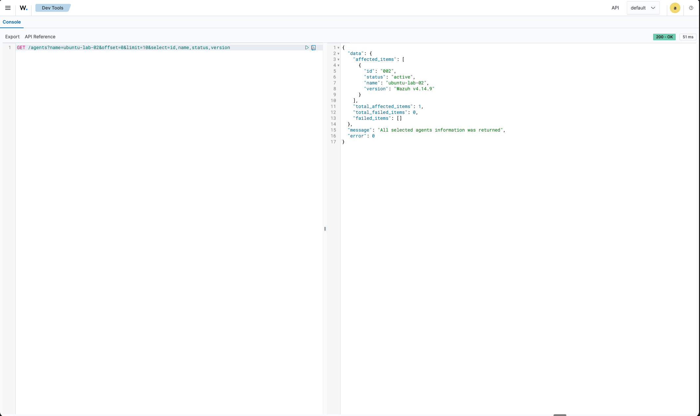
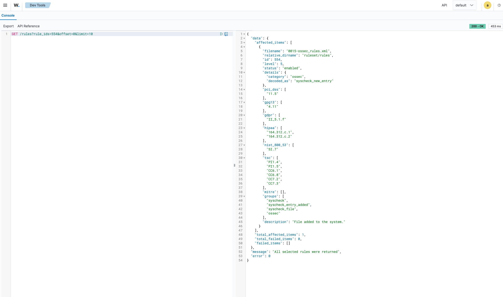
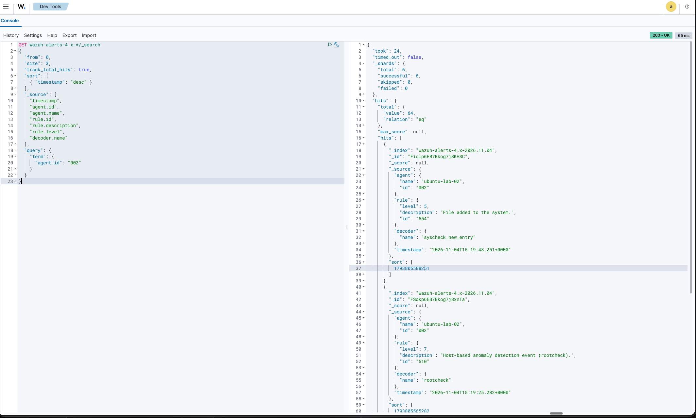
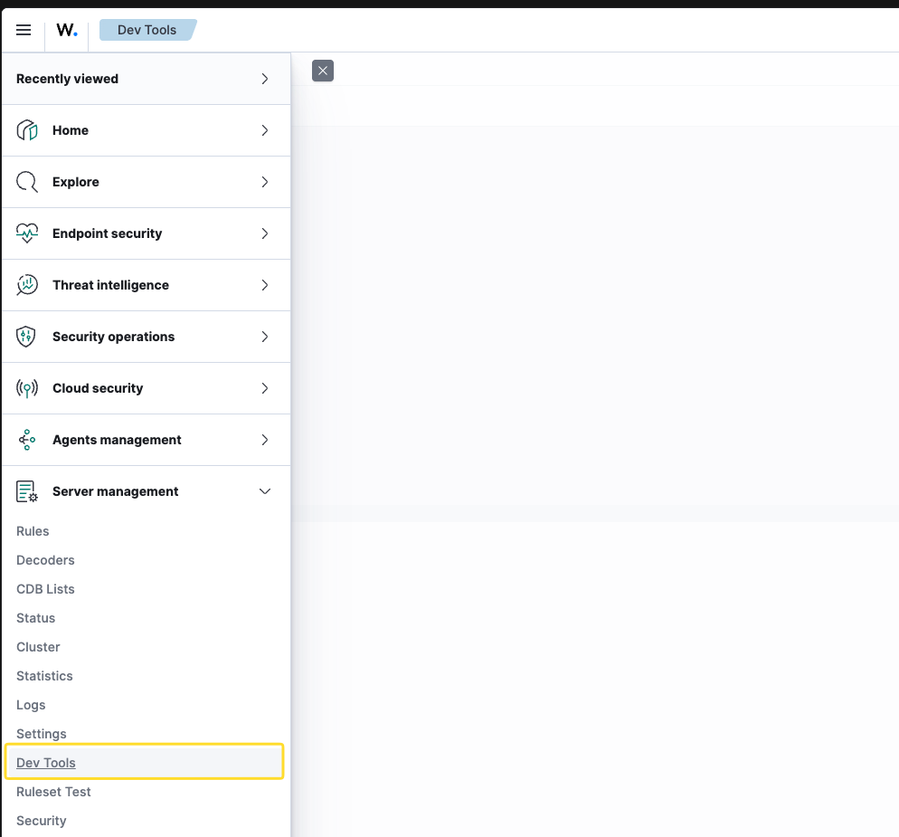
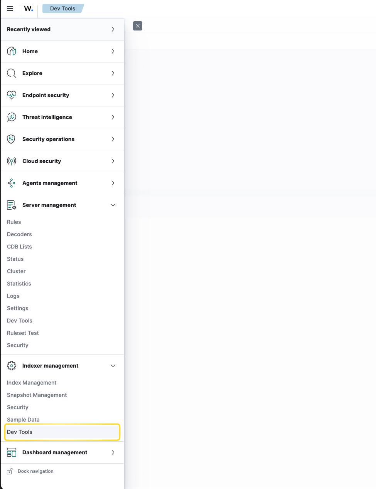

# Real Owned-Lab API Evidence: C1-C3 Collected

I have integrated three genuine lab dashboard API responses for [Phase 3 question 2](../../PHASE3.md). I ran these requests in my lab and provided the JSON and screenshots to the AI for documentation. I preserved the supplied values and native types, formatting the JSON for readability. These are real API responses, distinct from the proposed service and the separate synthetic evaluation cases.

## Collected evidence

| Capture | Response JSON | Supporting screenshot | Observation |
|---|---|---|---|
| C1, agents | [Complete inline response](#c1-agent-response) | [Manager agent response](../img/manager-agent-002-response.png) | One active agent, string ID `002`, name `ubuntu-lab-02`, agent version `Wazuh v4.14.9`. |
| C2, rule context | [Complete inline response](#c2-rule-response) | [Manager rule response](../img/manager-rule-554-response.png) | Enabled rule, numeric ID `554`, level 5, description `File added to the system.`, decoder context `syscheck_new_entry`. |
| C3, alert evidence | [Complete inline response](#c3-alert-search-response) | [Indexer search response](../img/indexer-agent-002-alert-search-success.png) | Three returned hits for agent `002`, 64 exact matches for this query at capture time, not 64 returned records or a universal alert count. |

I can correlate agent `002` to the first returned alert and then to rule `554`. The Manager rule ID is a number; the Indexer rule ID is a string. I retain both native representations. The first alert has timestamp `2026-11-04T15:19:48.251+0000`, level 5 and decoder `syscheck_new_entry`, matching the rule metadata. The other two hits have rule `510`, level 7 and rootcheck descriptions; those titles alone do not establish compromise or attacker activity.

Both Manager responses contain `error: 0`, one affected item, total 1, zero failed items and an empty failure list. Their screenshots each show HTTP `200 - OK`. This establishes the observed filtered response, not unrestricted visibility over all agents or rules. The Indexer response reports `timed_out: false`, six total/successful shards, zero skipped/failed shards and `hits.total.relation: eq`. These are observed completeness indicators for the query, not proof of RBAC or DLS restrictions. Only the first three hits were requested.

The Indexer screenshot shows HTTP `200 - OK`, response `took: 24` (server search time in milliseconds) and a separate UI duration of 65 ms. Neither is assistant or end-to-end service performance. The screenshot shows the full request but only a visible portion of the response; the inline C3 response below preserves all three supplied hits.

I pair each exact non-secret dashboard request with its complete native response and screenshot below. Authentication remains outside these artifacts.

## C1: Agent response

**Exact request, Manager console:**

```http
GET /agents?name=ubuntu-lab-02&offset=0&limit=10&select=id,name,status,version
```

<details>
<summary>Complete C1 Manager response and success screenshot</summary>

**Native response:**

```json
{
  "data": {
    "affected_items": [
      {
        "id": "002",
        "status": "active",
        "name": "ubuntu-lab-02",
        "version": "Wazuh v4.14.9"
      }
    ],
    "total_affected_items": 1,
    "total_failed_items": 0,
    "failed_items": []
  },
  "message": "All selected agents information was returned",
  "error": 0
}
```



</details>

## C2: Rule response

**Exact request, Manager console:**

```http
GET /rules?rule_ids=554&offset=0&limit=10
```

<details>
<summary>Complete C2 Manager response and success screenshot</summary>

**Native response:**

```json
{
  "data": {
    "affected_items": [
      {
        "filename": "0015-ossec_rules.xml",
        "relative_dirname": "ruleset/rules",
        "id": 554,
        "level": 5,
        "status": "enabled",
        "details": {
          "category": "ossec",
          "decoded_as": "syscheck_new_entry"
        },
        "pci_dss": ["11.5"],
        "gpg13": ["4.11"],
        "gdpr": ["II_5.1.f"],
        "hipaa": ["164.312.c.1", "164.312.c.2"],
        "nist_800_53": ["SI.7"],
        "tsc": ["PI1.4", "PI1.5", "CC6.1", "CC6.8", "CC7.2", "CC7.3"],
        "mitre": [],
        "groups": ["syscheck", "syscheck_entry_added", "syscheck_file", "ossec"],
        "description": "File added to the system."
      }
    ],
    "total_affected_items": 1,
    "total_failed_items": 0,
    "failed_items": []
  },
  "message": "All selected rules were returned",
  "error": 0
}
```



</details>

## C3: Alert search response

**Exact request, Indexer console:**

```http
GET wazuh-alerts-4.x-*/_search
```

**Request body:**

```json
{
  "from": 0,
  "size": 3,
  "track_total_hits": true,
  "sort": [{"timestamp": "desc"}],
  "_source": [
    "timestamp",
    "agent.id",
    "agent.name",
    "rule.id",
    "rule.description",
    "rule.level",
    "decoder.name"
  ],
  "query": {"term": {"agent.id": "002"}}
}
```

I bounded the returned page and selected fields in this recorded query, not its time range. It contains no timestamp filter and therefore does not demonstrate the proposal's 24-hour lookback control. Dashboard GET-body handling is observed here; compatibility through the proposed service ingress remains untested.

<details>
<summary>Complete C3 Indexer response and success screenshot</summary>

**Native response:**

```json
{
  "took": 24,
  "timed_out": false,
  "_shards": {
    "total": 6,
    "successful": 6,
    "skipped": 0,
    "failed": 0
  },
  "hits": {
    "total": {"value": 64, "relation": "eq"},
    "max_score": null,
    "hits": [
      {
        "_index": "wazuh-alerts-4.x-2026.11.04",
        "_id": "Fiolp6EB7Bkog7j8KHSC",
        "_score": null,
        "_source": {
          "agent": {"name": "ubuntu-lab-02", "id": "002"},
          "rule": {"level": 5, "description": "File added to the system.", "id": "554"},
          "decoder": {"name": "syscheck_new_entry"},
          "timestamp": "2026-11-04T15:19:48.251+0000"
        },
        "sort": [1793805588251]
      },
      {
        "_index": "wazuh-alerts-4.x-2026.11.04",
        "_id": "FSokp6EB7Bkog7j8xnTa",
        "_score": null,
        "_source": {
          "agent": {"name": "ubuntu-lab-02", "id": "002"},
          "rule": {"level": 7, "description": "Host-based anomaly detection event (rootcheck).", "id": "510"},
          "decoder": {"name": "rootcheck"},
          "timestamp": "2026-11-04T15:19:25.282+0000"
        },
        "sort": [1793805565282]
      },
      {
        "_index": "wazuh-alerts-4.x-2026.11.04",
        "_id": "FCokp6EB7Bkog7j8wnTu",
        "_score": null,
        "_source": {
          "agent": {"name": "ubuntu-lab-02", "id": "002"},
          "rule": {"level": 7, "description": "Host-based anomaly detection event (rootcheck).", "id": "510"},
          "decoder": {"name": "rootcheck"},
          "timestamp": "2026-11-04T15:19:25.172+0000"
        },
        "sort": [1793805565172]
      }
    ]
  }
}
```



</details>

## Console navigation and process

I keep navigation separate from response evidence because the Manager and Indexer are different API planes. The two navigation screenshots show where each console is opened, not API results.

<details>
<summary>Dashboard console navigation screenshots</summary>

Manager, Server management > Dev Tools:



Indexer, Indexer management > Dev Tools:



</details>

The earlier reported attempt to run an Indexer search in the Manager console is not represented by any of these five images. I do not present a 404 screenshot or treat that report as a captured permission/failure experiment.

## Provenance, privacy and remaining limits

I document requests I ran in my lab; AI organized the supplied artifacts without executing a fresh API run or independently validating lab ownership. I supplied no capture timestamp, request ID, Manager version or Indexer version. The alert timestamps are event fields, not capture times. Version `4.14.9` is verified only for the agent in C1.

I inspected all five local images and found no visible credentials or authentication headers. I supplied no credentials with the JSON. I retained the supplied lab name, agent/rule IDs, document IDs and event timestamps without claiming anonymization or redaction. I renamed the PNGs without resampling, cropping or encoding, preserving their SHA256 identities. Publication is not authorized by this integration; I would review these lab identifiers and provenance again before publication.

The reads do not validate the effective principal, restricted Manager RBAC/Indexer DLS, cross-tenant isolation, provider-internal Cloud route, MCP, private inference, the proposed four-tool workflow, model quality or latency budgets. I would validate those integration and operating contracts through the [before-pilot checklist](../../OPEN-QUESTIONS.md), not infer them from successful lab responses.

For optional C4 preparation, I could later repeat bounded reads with an intended restricted principal, inspect a second page or a known-empty filter, and test controlled incomplete/failure cases. This would not be a mandatory fourth PDF capture: the original assignment (p. 3) asks for real API responses, not four captures or failure experiments. I would not manufacture failures or disrupt the deployment.

<details>
<summary>Canonical response fidelity</summary>

I recorded these SHA256 fingerprints from the original parsed responses before consolidation. To reproduce one, parse the corresponding block labeled **Native response**, serialize it with Python `json.dumps(value, sort_keys=True, separators=(",", ":"), ensure_ascii=False, allow_nan=False)`, and hash the UTF-8 bytes with no final newline. This preserves array order and distinguishes native numeric, string, boolean and null values. The C3 request body is not a response and is excluded.

| Response | Canonical parsed-JSON SHA256 |
|---|---|
| [C1, agent](#c1-agent-response) | `f2399ce3b38239bda69b44e197d737bcd7f60abee41bbeb56f87c81cb54a6d32` |
| [C2, rule](#c2-rule-response) | `db4be3797b97e94650cb9696d3b2b24b9879b3e4ed47fa6a6e42a0df8e01d7d4` |
| [C3, alert search](#c3-alert-search-response) | `30de6ab8017d9a3116446a915e4f7647de79557a38cb91d16ed2089342746c77` |

</details>

## Retained interface references

- [Manager API](https://documentation.wazuh.com/current/user-manual/api/reference.html).
- [Indexer API](https://documentation.wazuh.com/current/user-manual/indexer-api/reference.html).
- [Cloud technical FAQ](https://documentation.wazuh.com/current/cloud-service/your-environment/technical-faq.html).
- [Cloud limitations](https://documentation.wazuh.com/current/cloud-service/your-environment/limitations.html).
