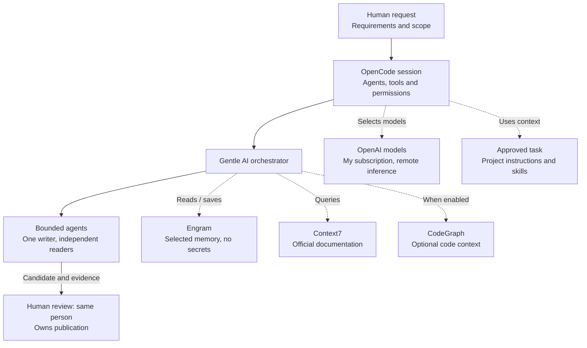

# Phase 4: Plan How to Build It with AI

I use AI to investigate, write and check bounded work, not to choose product direction or take responsibility for a release. This document separates how I used AI during this task from how I would build and operate the proposed service. The repository contains a design, lab evidence and an evaluation plan, not an implemented MCP server, hosted assistant or tested model deployment.

**Reading path:** Question 1 explains my tools and actual authoring experience. Questions 2 and 3 describe proposed delivery and verification. The [work-unit brief](assets/agent-instructions/WORK-UNIT-BRIEF.md) contains a curated account of agent direction and one concrete future task example. Questions 4 to 8 cover responsibility, feedback, incidents, growth and documentation.

## 1. How did you use AI in phases 2 and 3, where did it help you and where did you have to correct it?

### My working environment

I use **[OpenCode](https://opencode.ai/docs/agents/) [S1] as my coding client and working environment**, with OpenAI models connected through my subscription in OpenCode's provider configuration. OpenCode hosts the conversation, model selection, tools and agents.

[Gentle AI](https://github.com/Gentleman-Programming/gentle-ai) [S2] provides the orchestration guidance I use inside OpenCode: it coordinates bounded tasks and passes relevant context to workers. The coding model provider is a different layer from the MCP tools that supply context:

| Layer | How I use it | Important limit |
|---|---|---|
| OpenCode and OpenAI models | Discuss requirements, inspect material, write and check authorized changes. | Subscription access does not authorize customer-data processing. Provider inference is remote, not hosted on my Mac. |
| Gentle AI orchestrator | Divide work when useful and coordinate results and one writer. | Delegation does not expand the task's permissions. |
| [Engram](https://github.com/Gentleman-Programming/engram) [S3] | Retain selected project context, decisions and evidence locations across sessions. | It is not a secret store or a shared live context window. Retrieved context still needs checking. |
| CodeGraph, optional | Find relevant code and relationships when enabled and useful. | I sometimes use it and sometimes work without it. It does not replace reading or testing the actual change. |
| Context7 | Retrieve official library documentation for bounded public queries. | It is an external context tool, not my coding model provider. Queries must not contain private material. |

Project instructions, relevant skills, the approved task and tool permissions shape what agents know and can do. I normally use direct task-based orchestration and ordinary tests and review, not SDD or RDD ceremonies. More substantial work may need a written plan, but a framework is not a prerequisite for a small change.

The diagram below shows this **actual authoring arrangement**. Follow the solid path from my request through OpenCode, Gentle AI and bounded agents to my review; the two human nodes represent me at different stages, not separate people. Independent readers support one coordinated writer when useful. Dotted links show supporting model selection and context tools, not extra delivery steps. OpenCode selects the subscription models in the combined OpenAI node; inference runs remotely. Engram reads and saves are limited to selected context and sanitized decisions. Only public, synthetic or approved redacted development material belongs here. The proposed product's private inference is a separate environment, not this subscription connection.

Editable source: [development-environment.mmd](assets/diagrams/development-environment.mmd). Mermaid uses the host's default theme rather than fixed light-only text colors.

### Phase 2: research helped, but I had to own the choice

I used AI for bounded community and source comparisons, including existing Wazuh capabilities, integrations and competing approaches. Independent read-only roles helped cover different sources; their reports were inputs to my decision, not proof through agreement. I asked for clearer arguments and restored useful community evidence when shortening the research removed too much context. No customer interviews or runtime benchmarks established demand or effectiveness.

The discussion initially favored reporting and follow-up. I challenged ticket creation as the main solution because existing integrations already address parts of that workflow. Later, rereading the assignment exposed a requirement both I and the assistant had missed: AI needed to be inside the proposed service, not only used to build it. I redirected the proposal toward an investigation assistant, drawing on my Prowler MCP/Lighthouse experience as qualitative context rather than measured adoption evidence.

I also corrected the product boundary: an **official Wazuh-maintained open-source MCP server** should be a first-class deliverable, with private hosted chat as one client. Community operators could choose their own authorized deployments and models, including external providers. That would not extend hosted SaaS privacy guarantees to those clients or remove server authentication, effective-user permissions and credential protection. Local or official MCP does not imply local inference or compliance.

The [research history](../phase2/research/RESEARCH-HISTORY.md) records the direction changes and distinguishes recovered records, translated excerpts and editorial explanation. It is not a byte-exact transcript of all private conversations.

### Phase 3: design assistance was not implementation evidence

AI helped organize the architecture, diagrams, sources and [private evaluation plan](../phase3/assets/evaluation/EVALUATION-PLAN.md), including **20 synthetic planned cases**. I requested promptfoo based on my previous experience, not because AI discovered an existing Wazuh pipeline. I performed the lab work and supplied **three real API captures and five screenshots**. AI helped interpret and present them; those reads did not exercise the proposed MCP, SaaS, model serving or evaluation harness.

My corrections were substantive as well as editorial. I clarified Manager versus Indexer navigation and responsibilities, narrowed overly broad tools, and separated model planning from backend execution. The intended hosted path became a question, a structured model plan, authorized backend tool results, then a second model explanation with checked citations. I required distinct behavior for API failure, model failure and both failing together. I also corrected Mermaid syntax, contrast and readability instead of treating a plausible-looking diagram as sufficient.

The latest [Phase 3 design](../phase3/PHASE3.md#product-traces-operational-events-and-retention) would retain protected content-bearing product traces separately from metadata-only operational logs. Questions, answers and authorized tool context would have scoped, audited regional access and a separately proposed 30-day retention policy. Private inference would not mean no retention, and those traces would not automatically enter coding-agent context, Engram, training or evaluation datasets.

For overlapping documentation, I used one coordinated writer and independent read-only review roles. This account and the supporting brief make the direction and corrections visible without publishing private prompts, account configuration or sensitive records. This documentation work was not a strict TDD exercise or a service implementation.

## 2. How would you split the work of building the service between you and your agents?

### Start with an approved backlog item

Every implementation would start from an approved ticket, issue or task in a prioritized backlog. I would own the problem, requirements, scope, acceptance criteria and priority. AI could help refine the ticket, expose missing failure cases and suggest test expectations; it would not invent product direction or treat an unapproved idea as consent to implement. Ambiguous requirements would return to me before writing.

I would turn the selected ticket into a **work-unit brief**: a concrete handoff combining approved requirements with relevant repository context, allowed files and tools, test expectations and stop criteria. This is a practical document, not a mandatory OpenCode or Gentle AI protocol. The [supporting brief and planned `agents_list` example](assets/agent-instructions/WORK-UNIT-BRIEF.md#example-planned-read-only-agents_list-task) show what that would look like without inventing an existing issue or implementation.

| Responsibility | Owner |
|---|---|
| Requirements, priority, scope and acceptance decisions | Me, with responsible product/security/platform owners where needed. |
| Bounded source research and repository exploration | Read-only agents where separate questions justify parallel work. |
| Implementation, tests and related documentation | One coordinated writer per worktree, within the approved brief. |
| Independent challenge of the candidate | Fresh read-only reviewer with requirements, exact candidate and evidence. |
| Publication, release, communication and incident decisions | Humans. An agent could perform specifically authorized delivery actions, never merge. |

### Deliver a checked candidate, then ask permission to publish

I would first establish useful unit, integration and contract tests, then deliver small vertical changes against that base. A reasonable initial backlog would cover scoped MCP reads, the hosted plan/tool/explanation path, tenant isolation and trace handling, then UI and rollout readiness. Each would still need its own accepted requirements and failure tests; this ordering is not permission to build them now.

Agents would run appropriate tests during implementation, perform self-review and return a candidate with observed results. A fresh reviewer would inspect the same candidate without relying on the implementer's reasoning. That can expose assumptions the writer missed, but agreement between agents would not prove correctness. I would agree a round/time/scope budget; missing authority, unresolved risk, repeated findings without progress or exhausted budget would stop for human judgment. Corrections would stay within the approved ticket and rerun affected checks.

**Permission to implement would not authorize a commit, push or PR.** After reviewing the local candidate and evidence, I would explicitly authorize those actions for the exact delivery scope, or leave it local. An authorized agent could then commit, push and open or update the PR. My review and at least one other human review would be required before production, alongside current required checks. Agents would never approve or merge on my behalf. Approved CI could carry out deployment after human release authorization; I would not manually perform an automatic pipeline step.

The diagram below is the **proposed future delivery flow**, not installed CI. Ideas and feedback enter the human-owned backlog first. Tests are part of implementation, and the separate publication gate comes before every agent Git-delivery action. A changed delivery scope would require renewed permission.

Editable source: [agent-delivery-workflow.mmd](assets/diagrams/agent-delivery-workflow.mmd).

```mermaid
flowchart LR
    Idea["Idea or feedback"]
    Backlog["Human-prioritized backlog: approved ticket and acceptance criteria"]
    Brief["Task brief: context, scope, permissions, tests and stop budget"]
    Clear{"Requirements and authority clear?"}
    Stop["Stop for human clarification or decision"]
    Writer["One writer: scoped code, tests and docs"]
    Checks["Run tests throughout and self-review"]
    Fresh["Fresh read-only review of exact local candidate and evidence"]
    Ready{"Acceptance met and findings resolved?"}
    Budget{"Correction within approved scope and budget?"}
    Author["My review of candidate, tests and limitations"]
    Permission{"Explicit permission for this commit, push and PR scope?"}
    Local["Keep local, report status and await permission"]
    Publish["Authorized agent: commit, push and open or update PR"]
    Required["Current required CI and security checks, if configured"]
    Humans["My review and another human review of final candidate"]
    Merge["Humans only: approve, merge and authorize release"]
    Deploy["Approved pipeline deploys, verifies rollout and supports rollback"]
    Idea --> Backlog
    Backlog --> Brief
    Brief --> Clear
    Clear -->|"No"| Stop
    Clear -->|"Yes"| Writer
    Writer --> Checks
    Checks --> Fresh
    Fresh --> Ready
    Ready -->|"No"| Budget
    Budget -->|"Yes"| Writer
    Budget -->|"No"| Stop
    Ready -->|"Yes"| Author
    Author -->|"Changes needed"| Budget
    Author -->|"Acceptable"| Permission
    Permission -->|"No"| Local
    Permission -->|"Yes"| Publish
    Publish --> Required
    Required -->|"Failures"| Budget
    Required -->|"Passing or approved policy exception"| Humans
    Humans -->|"Changes needed"| Budget
    Humans -->|"Approved"| Merge
    Merge --> Deploy
```

## 3. How would you check that what your agents produce is correct and safe before it reaches users?

I would verify behavior against the approved ticket from the beginning, not wait for a final AI review. I would keep **code correctness, product answer quality and production readiness** separate: none proves the other two.

### Build a test base and use TDD where it fits

I try to use TDD when the project structure and test maturity support it, especially for maintenance and bug fixes. An agent would first reproduce the required behavior in a failing test, make the smallest change that passes, then refactor while keeping it green. For a new service, establishing testable boundaries, fixtures and unit/integration/contract coverage would make that cycle practical. If a meaningful runnable test were unavailable, the agent would explain the gap and run suitable checks, not claim a red/green cycle it had not performed.

| Layer | Evidence I would require |
|---|---|
| Unit and contract behavior | Typed inputs/outputs, query limits, errors, authorization decisions and compatibility tests for each changed contract. |
| Integration and security | Effective-user permissions across Manager/Indexer, cross-tenant denial, expired/revoked access, injection, credential exclusion, egress and scoped trace access/deletion. |
| Hosted AI behavior | The [Phase 3 evaluation plan](../phase3/assets/evaluation/EVALUATION-PLAN.md): expected facts, supported citations, refusals, partial results, API/model outages and deterministic budgets. |
| Release readiness | Applicable static/type, dependency and secret checks, human review, approved private evaluation results, rollout monitoring and a tested recovery procedure. |

The official MCP's authentication, bounded reads and schemas would be tested independently of any model. Hosted semantic quality would need human assessment or a calibrated private offline judge as well as deterministic assertions. A valid citation ID alone would not prove its sentence is supported. The offline evaluator would not become a hidden third model call in the hosted request path.

### Review evidence, not confidence

For each candidate, agents would report exact files/version, commands and observed results, skipped checks and unresolved findings. A changed candidate would invalidate affected results and need another check. Fresh AI review would challenge the result; my review and another human's review would provide accountable judgment before production. Neither a test count nor reviewer consensus would excuse a failed authorization boundary.

If approved and configured, CI, dependency/security scanning and tools such as CodeRabbit could add findings. They would not replace tests or human approval, and external code processing would need organizational approval. This repository does not establish an implemented service, installed CI, passing security scans or executed model evaluations. I would select real commands from the future repository's toolchain, not invent them here.

## 4. Which part of the work would you not leave to an agent, and why?

I would not delegate final product direction, backlog priority, acceptance, privacy/risk decisions, release approval, public commitments or incident command. These require authority and accountability to customers and colleagues. AI could investigate alternatives and prepare recommendations, but could not accept those consequences for us.

I would keep data authorization separate from technical access. My OpenCode subscription models and external context tools would receive only public, synthetic or approved redacted development material. A local tool or model would not itself authorize access to customer data. Protected product traces would remain in the proposed regional SaaS environment with explicit tenant/content-scoped grants and audited reads; being a developer or support operator would not automatically grant content access.

Implementation, publication and release would be distinct permissions. An agent would request explicit authorization before committing, pushing or opening/updating a PR, even after permission to edit. It would never merge. I would own the accuracy of communications an agent helped prepare and approve the disclosure scope. Missing evidence, unclear requirements or unclear authority would mean stop and ask, not infer consent.

## 5. If users gave you feedback on the service, how would you handle it?

I would connect feedback to the same backlog and delivery process described in Question 2, not create a parallel route from a report to code:

1. **Receive and classify.** I would acknowledge the report, identify the user need and classify it as a bug, feature request, usability problem or incident. I would request missing information. Urgent security reports and outages would enter the [Question 6 incident lane](#6-if-users-report-that-the-service-is-down-how-would-you-be-ready-to-respond), with follow-up backlog actions, rather than wait behind features.
2. **Maintain one canonical backlog record.** I would link the report to an existing related issue or create a ticket when needed, recording the problem, expected versus observed behavior, bug reproduction, impact and approved evidence. Related reports would remain linked, not become duplicate implementation tasks. The record would carry an owner, status, priority, acceptance criteria and failure/test expectations.
3. **Make the human decision.** I would prioritize by security, impact, obligations, recurrence and roadmap fit, or defer/decline with a reason. Votes would be signals, not customer counts. AI could prepare ticket text from authorized material, but not approve scope, priority or permissions. An approved, ready backlog item would be the only entry point for agent implementation.
4. **Use the existing delivery gates.** From that ticket, I would derive the [work-unit brief](assets/agent-instructions/WORK-UNIT-BRIEF.md#reusable-handoff-fields) and follow [Question 2's backlog workflow](#start-with-an-approved-backlog-item): one writer, requirements/tests/docs, normal review and explicit permission before commit, push or PR actions. Only humans would approve merge and release.
5. **Close the loop.** I would update the same ticket with verified acceptance, the linked PR and release status, then notify the original reporter. Deferrals and declines would also receive an explanation, without promised dates.

Non-sensitive official MCP feedback could be public; SaaS tenant details, vulnerabilities and incidents would use private support. Authorized reviewers could inspect protected traces, not automatically reuse them as coding prompts or fixtures. Updates would disclose no sensitive data. Open-source MCP and hosted SaaS would retain distinct support expectations and inference/privacy boundaries.

## 6. If users report that the service is down, how would you be ready to respond?

The first goal would be to detect failures and alert the responsible team before customers need to report them. Monitoring, synthetic canaries and dependency health checks would be in place before a pilot, with actionable alerts routed to the agreed incident owner or on-call team. User reports would remain an additional signal for failures those checks missed, not the main way to discover an outage. A short runbook would name the incident owner, escalation route, rollback/disable procedure and customer update process. On-call coverage and SLA remain decisions to agree, not response times I can promise now. Incidents would use an urgent human-led lane, with an approved incident task recording authority and recovery checks rather than waiting behind feature work.

1. **Confirm scope safely.** Verify identity and authorization for the affected deployment, collect timestamps/request references and assess impact. An email address alone would not establish access rights.
2. **Separate dependencies.** Check the Wazuh API planes, private model, application/admission state and required protected trace capture. Distinguish a failed investigation from a failed native Wazuh component.
3. **Restore under human authority.** The responsible person would choose rollback, capacity action or disabling chat. Approved tools/pipelines could execute it. AI could help interpret minimized diagnostics only inside an approved private environment.
4. **Communicate and prevent recurrence.** Keep users informed, verify recovery, then record cause, corrective actions and regression expectations in a private postmortem. Publish only an approved non-sensitive summary.

The [Phase 3 outage behavior](../phase3/PHASE3.md) would remain the contract: API failure must not become "no threats"; model failure could still allow authorized deterministic facts where available; both failing would return unavailable. Required trace-capture failure would also return unavailable, not fall back to plaintext logs. There would be no silent external model fallback. Native Wazuh alerting would remain independent of chat, subject to the health of its own dependencies.

Operational logs would be metadata-only. Any necessary content investigation would require separate scoped authorization to protected traces, not automatic copying into OpenCode, Engram or public issues. Follow-up fixes would enter the approved backlog with reproduction and regression criteria; urgency would not give an agent permission to merge or publish without authorization.

## 7. If it grew into a full service with more features and more customers, how would you keep the design integrated?

I would preserve one coherent investigation experience and shared contracts instead of letting each agent invent a feature-specific architecture. Shared UI components, evidence links, errors and accessibility conventions would make new capabilities understandable. New work would start from the same prioritized backlog and include its effects on existing behavior and documentation.

I would begin with [Phase 3's minimal deployable baseline](../phase3/PHASE3.md#minimal-deployable-baseline), keeping clear logical boundaries for identity/policy, orchestration, MCP/context, inference and protected storage. A module would become a separate deployment only when isolation, scaling or ownership justified the operational cost. Brief architecture decisions and contract tests would help different contributors preserve those boundaries.

I would version the official MCP's schemas and releases independently from hosted assistant behavior, with compatibility tests and migration notes. Community clients could choose their own models and retention policies, but server authentication, scoped reads and credential protection would remain mandatory. Hosted private-inference promises and aggregate model/GPU budgets would not become promises for arbitrary community clients.

Growth would require measurement: representative load, p95 latency, answer quality, trace volume/deletion, GPU warm capacity, queue/backpressure and tenant fairness. Autoscaling would have startup delays, quotas and cost limits, not unlimited instant capacity. I would stage releases with rollback readiness and evaluate model/prompt/tool/permission changes against the same regression baseline. A move from a few users to thousands would need evidence before changing topology or making capacity commitments.

## 8. How would you document it, and how would you make sure every change is backed by up-to-date documentation?

I would keep documentation in the same work unit as the behavior it explains. The approved ticket would identify affected audiences and contracts, and the agent would update the relevant docs or explain why no update was needed. A human would review that explanation. Documentation would be part of acceptance, not a separate task indefinitely deferred after implementation.

| Audience | Documentation I would maintain |
|---|---|
| Users | Supported investigations, evidence/uncertainty, permissions, privacy/retention and failure behavior. |
| MCP integrators | Versioned tool contracts, authorized deployment/client setup, compatibility and release notes. Server security and client model choices would be explicit. |
| Developers | Architecture decisions, boundaries, local test setup, synthetic examples and evaluation expectations. |
| Operators/support | Dependency health, capacity, scoped diagnostic access, recovery, retention/deletion and incident communication runbooks. |

Agents would receive relevant project instructions and skills plus the task-specific [brief](assets/agent-instructions/WORK-UNIT-BRIEF.md), not an entire private transcript. The brief is a curated public representation of actual direction and a reusable future template; it is not every original prompt or an active configuration file. I would preserve meaningful decision history while excluding credentials, private configuration and customer data.

I would keep Mermaid sources editable and exactly aligned with embedded diagrams. Proposed CI could check links, schemas, examples and diagram consistency, and require a documentation update or a human-approved exception. Those controls would need real configuration and repository policy before I called them enforced. AI could flag drift, but humans would still verify that instructions describe the current contract. This round used local source checks, not service tests or visual rendering certification.

Before implementation, the team would agree on access and data-retention policies, support responsibilities and release checks, using the [before-pilot checklist](../phase3/OPEN-QUESTIONS.md).

### Retained source references

- **S1:** [OpenCode agents and model selection](https://opencode.ai/docs/agents/).
- **S2:** [Gentle AI](https://github.com/Gentleman-Programming/gentle-ai).
- **S3:** [Engram](https://github.com/Gentleman-Programming/engram).
